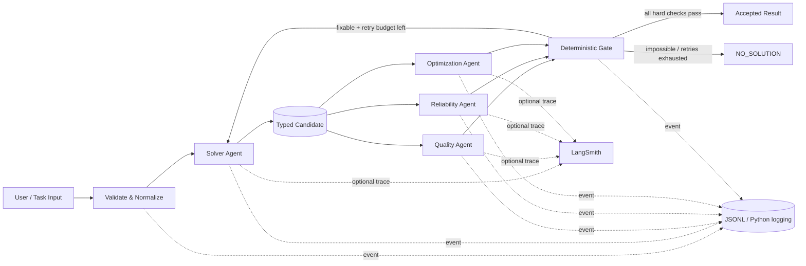

# Сравнение LangGraph, CrewAI, AutoGen/AG2 и чистого Python для мультиагентной LLM-системы на хакатоне

## Executive summary

Для команды из 3–5 человек, знакомой с Python и базовыми LLM API, при горизонте в несколько дней я бы выбрал **LangGraph как оркестратор + Pydantic-контракты на границах агентов + обычный Python `logging`/JSONL как обязательный локальный лог + LangSmith только как опциональный слой трассировки**.

Причина не в том, что LangGraph дает самый короткий Hello World. CrewAI и минимальный чистый Python могут дать первую демонстрацию быстрее. Преимущество LangGraph проявляется примерно через несколько часов, когда появляются именно ваши требования: три независимых агента качества/надежности/оптимизации, возврат `NO_SOLUTION`, ограниченные ретраи, детерминированный финальный gate, возможность посмотреть состояние после каждого шага и отсутствие необходимости доверять скрытой логике фреймворка. LangGraph намеренно является низкоуровневым orchestration runtime: состояние, узлы и переходы задаются явно, причем узлы остаются обычными Python-функциями; можно смешивать LLM-шаги и полностью детерминированную логику. citeturn18view0turn18view1turn19view5

**Моя оценка wall-clock time**, а не опубликованный benchmark, для команды указанного размера:

| Вариант | До первого работающего multi-agent MVP | До устойчивого demo-ready прототипа | Итог для хакатона |
|---|---:|---:|---|
| **LangGraph** | **4–7 ч** | **1–1.5 дня** | **Лучший баланс; рекомендую** |
| CrewAI | 3–5 ч | 0.5–1.5 дня | Лучший вариант, когда главное — максимально быстро показать «команду агентов» |
| AG2 v1 | 5–9 ч | 1–2 дня | Технически сильный, но API только что прошел большой v1-переход |
| Microsoft AutoGen | 4–8 ч | 1–2 дня | **Не начинал бы новый проект:** проект официально в maintenance mode |
| Чистый Python | **2–4 ч** для линейного pipeline | 1–2 дня после добавления retries/tracing/state/concurrency | Отличен, если workflow гарантированно останется маленьким |

Диапазоны выше — инженерная оценка на основании размера и уровня API в официальных quickstart/architecture docs, а не измеренная производительность фреймворков. CrewAI дает высокоуровневые Crews/Tasks и Flows, LangGraph требует явно собрать граф, AG2 v1 использует async `Agent`/`Network`, а в чистом Python вся инфраструктура остается на команде. citeturn18view0turn19view2turn16view4

Есть важная актуальная на **8 сентября 2026 года** развилка в названии «AutoGen/AG2». **Microsoft AutoGen и AG2 уже нельзя считать одним продуктом.** Microsoft официально перевел AutoGen в maintenance mode: новых features/enhancements не планируется, новым пользователям рекомендуется Microsoft Agent Framework. В AG2, напротив, летом 2026 произошел переход на новую v1-архитектуру: `import ag2`, новый `Agent`, а старые `ConversableAgent`, `GroupChat` и namespace `autogen` вынесены в отдельный AG2 Classic. Последний обнаруженный tag нового AG2 — **v1.0.4 от 7 сентября 2026 года**, то есть буквально за день до даты этого анализа. citeturn18view8turn16view4turn17view0

Отсюда практический ranking для вашего случая:

**LangGraph > CrewAI ≈ чистый Python > AG2 v1 >> новый проект на Microsoft AutoGen.**

CrewAI поднимается на первое место только при другой оптимизации: «за 3 часа показать эффектную автономную команду ролей». Чистый Python поднимается на первое место, если система фактически представляет собой фиксированный pipeline вроде `generate → verify → optimize → finish` и вы уверены, что ветвления, resumability, persistence и динамическая маршрутизация не понадобятся.

## Сравнительная матрица

Оценки **1–5 ниже — моя оценка применимости именно к вашему хакатон-сценарию**, а не официальные рейтинги проектов.

| Критерий | LangGraph | CrewAI | AG2 v1 | Microsoft AutoGen | Чистый Python |
|---|---|---|---|---|---|
| **Скорость старта** | **4/5**. Чуть больше boilerplate из-за State/Nodes/Edges. citeturn18view1 | **5/5**. Tasks/Crews и Flows быстро дают runnable workflow. citeturn18view4turn19view2 | **3.5/5**. API достаточно лаконичный, но async-first и новая Network-модель требуют освоения. citeturn16view4 | **3/5**. Хорошие APIs, но изучать их для нового проекта уже невыгодно из-за maintenance mode. citeturn18view8 | **5/5 для MVP**, 3/5 после появления надежности |
| **Прозрачность data flow** | **5/5**. Общий State, явные nodes/edges; `TypedDict`, dataclass или Pydantic. citeturn19view5 | **4/5**. Pydantic/JSON Task outputs и явный `context`; Flows дают state, Crews скрывают больше orchestration behavior. citeturn19view0turn19view2 | **5/5**. Typed structured outputs плюс Network channels/WAL. citeturn18view12turn16view4 | **5/5**. Communication только через serializable Pydantic/dataclass messages. citeturn18view9 | **5/5**, если команда дисциплинированно запрещает передачу невалидированных `dict`/строк |
| **Валидация / сериализация** | **5/5** с Pydantic на границах; state может быть Pydantic, хотя docs отмечают больший overhead против TypedDict/dataclass. citeturn19view5 | **5/5**. `output_json`, `output_pydantic`, guardrails и retries встроены в Task API. citeturn19view0turn19view1 | **5/5**. Pydantic/dataclass/primitives, validators, retries, fallback PromptedSchema. citeturn18view12 | **5/5** на уровне Core messages. citeturn18view9 | **5/5** с Pydantic; `model_validate*` дает ValidationError, `model_dump_json()` — JSON serialization. citeturn15view4turn15view5 |
| **Локальное логирование** | **5/5**. Узлы — Python functions, поэтому легко оборачиваются своим logger; плюс native tracing hooks/LangSmith. citeturn19view6turn19view4 | **4.5/5**. Event bus удобен для собственных handlers; визуальный built-in tracing существует, но CrewAI Tracing требует AMP account/auth. citeturn18view6turn18view5 | **5/5**. OpenTelemetry middleware для agent/LLM/tool/HITL spans. citeturn17view2 | **5/5**. Отдельные trace и structured event loggers плюс native OpenTelemetry. citeturn18view10turn18view11 | **3.5/5**: полная свобода, но все correlation IDs/spans/events делаете сами |
| **Объяснимость orchestration** | **5/5** | 3.5/5 для автономного Crew; **4.5/5 для Flow** | **4.5/5** | **4.5/5** | **5/5** |
| **`NO_SOLUTION` как first-class domain result** | **5/5** через state + conditional edge | **4.5/5** через Pydantic output + Flow/guardrail | **5/5**, особенно удобно через union schema | **4.5/5** через отдельный typed message | **5/5** |
| **Quality / reliability / optimizer agents** | **5/5** — очень естественный graph | **4.5/5** | **4.5/5** | 4.5/5 технически, но lifecycle снижает итог | **4/5** |
| **Persistence / restart** | **5/5**: checkpointers и stores встроены. citeturn18view2 | 4/5 | 4/5; Network имеет WAL/audit trail. citeturn16view4 | 5/5 архитектурно | 2/5 без собственной реализации |
| **Provider portability** | **5/5**: LangGraph не требует LangChain и node может вызвать любой Python client. citeturn18view0 | **5/5**: native SDKs + LiteLLM, включая OpenAI/Ollama. citeturn18view7 | **5/5**: extras для OpenAI, Anthropic, Gemini, Ollama и др. citeturn16view4 | **5/5**, docs имеют OpenAI и local Ollama/LiteLLM patterns. citeturn18view9 | **5/5** |
| **Зависимости / lock-in** | Средние | Средние/выше средних | Средние | Средние | **Минимальные** |
| **Лицензия** | MIT. citeturn19view4 | MIT. citeturn20view0 | Apache-2.0. citeturn16view5 | Код MIT, документация CC BY 4.0. citeturn20view1 | Зависит от выбранных библиотек |
| **Состояние проекта на 08.09.2026** | Активен; LangGraph 1.2.11 вышел 11 августа 2026. citeturn18view3 | Активен; текущая versioned docs — 1.15.20. citeturn18view5turn19view2 | **Очень активен, но v1 очень свежий**; 1.0.4 — 7 сентября 2026. citeturn17view0 | **Maintenance mode**. citeturn18view8 | Стабильность вашей архитектуры зависит от вас |

### Где появляется «чёрный ящик»

Есть два разных black box, и их стоит разделять.

Первый — **сама LLM**. Ни LangGraph, ни CrewAI, ни AG2, ни собственный `asyncio`-оркестратор не превращают внутреннее вычисление модели в доказуемую причинную трассу. Поэтому под «логированием решения агента» для практической системы лучше понимать **его вход, структурированный результат, вызовы tools, concise rationale/reason codes, evidence IDs, latency/tokens и переход состояния**, а не попытку записывать скрытые внутренние рассуждения модели.

Второй — **оркестрационный black box**, и вот здесь фреймворки сильно различаются. В LangGraph topology практически совпадает с вашим кодом: `State → Node → Edge`; nodes и edges — функции. citeturn18view1 CrewAI Crews сознательно поднимают уровень абстракции до автономного сотрудничества агентов, поэтому часть контекстной сборки, делегации и interaction loop становится менее очевидной; CrewAI Flows возвращают разработчику явный event-driven state/control flow. citeturn20view0turn19view2 AutoGen Core, напротив, чрезвычайно прозрачен на message layer — сообщения являются единственным способом коммуникации агентов и представляют собой serializable data. citeturn18view9 Новый AG2 Network также делает коммуникацию довольно наблюдаемой: Hub владеет registry, write-ahead log и audit trail, а взаимодействие идет через channels. citeturn16view4

Именно поэтому **для вашей задачи я предпочитаю LangGraph автономному CrewAI Crew**, но CrewAI Flow считаю гораздо более близким конкурентом LangGraph, чем классический role-playing Crew.

## Структурированные данные, ошибки и «нет допустимого решения»

Самый важный архитектурный прием не зависит от фреймворка: **не передавать между специализированными агентами свободный prose как API**.

Используйте контракт примерно такого вида:

```text
Solver:
    InputSpec
      ↓
    SolverOutput = Solved | NoSolution

Reviewer:
    {InputSpec, Solved}
      ↓
    Review {
        verdict,
        score,
        hard_violations[],
        recommendations[],
        retryable
    }

Gate:
    reviews[]
      ↓
    ACCEPT | RETRY | NO_SOLUTION
```

Pydantic подходит именно для такой границы: модели валидируют вход, при некорректных данных возникает `ValidationError`, а модели сериализуются в JSON через `model_dump_json()`. citeturn15view4turn15view5 Для OpenAI API официальный Python SDK позволяет передавать Pydantic-модель непосредственно в `client.responses.parse(..., text_format=...)`, после чего типизированный результат доступен как `response.output_parsed`. citeturn15view0turn21view0

### Поддержка `NO_SOLUTION`

Не стоит моделировать отсутствие решения строкой вроде `"Sorry, no solution found"`.

Надежнее сделать это **частью type system**:

```python
from typing import Annotated, Literal
from pydantic import BaseModel, Field


class Solved(BaseModel):
    status: Literal["solved"]
    solution: str
    evidence: list[str] = []
    confidence: float = Field(ge=0.0, le=1.0)


class NoSolution(BaseModel):
    status: Literal["no_solution"]
    reason_code: Literal[
        "constraints_inconsistent",
        "insufficient_information",
        "no_candidate_passed_gate",
    ]
    explanation: str
    violated_constraints: list[str] = []
    retryable: bool = False


Outcome = Annotated[
    Solved | NoSolution,
    Field(discriminator="status"),
]


class SolverOutput(BaseModel):
    outcome: Outcome
```

Это дает три существенных свойства: статус невозможно случайно потерять при передаче между агентами; `NO_SOLUTION` можно логировать и считать в метриках отдельно от технического exception; а оркестратор может завершить workflow **обычным детерминированным branch**, не спрашивая LLM, что делать дальше. Возможность строить state schemas на Pydantic/TypedDict и делать conditional routing является штатной моделью LangGraph. citeturn19view5turn18view1

В CrewAI аналогичный контракт можно поставить в `Task.output_pydantic` или `output_json`, а function guardrail может детерминированно принять или отклонить результат до передачи следующему task. citeturn19view0turn19view1 В новом AG2 structured-output слой принимает Pydantic/dataclass и другие типы, поддерживает validators/retries; для провайдеров без native structured output предусмотрен `PromptedSchema`. citeturn18view12

У Microsoft AutoGen есть `CantHandleException`, когда agent handler не умеет обработать **сообщение**, но я **не использовал бы его для доменного `NO_SOLUTION`**: это другой семантический уровень. Доменный отказ лучше представить отдельным Pydantic message/result, поскольку AutoGen Core специально отделяет serializable messages от processing logic. citeturn18view9

### Почему structured contract важнее выбора framework

Для хакатона наиболее частая авария мультиагентной системы выглядит не как exception, а так:

`agent A → длинный текст → agent B неправильно понял часть текста → agent C оптимизировал уже неверное предположение → финальный judge получил убедительно написанную ошибку`.

Типизированная граница резко уменьшает поверхность этой проблемы. Framework не гарантирует истинность LLM-вывода, но может гарантировать, что, например, `score=15.7` не пройдет при ограничении `0..1`, отсутствующий `status` будет выявлен и hard constraint нельзя будет незаметно превратить в комментарий. Это именно слой валидации Pydantic, поверх которого уже работают LangGraph/CrewAI/AG2. citeturn15view5

## Рекомендуемая архитектура

Для хакатона я **не рекомендую строить свободный group chat пяти агентов**. Это эффектно на демо, но хуже для воспроизводимости: больше LLM-turns, больше динамической истории, труднее понять, кто повлиял на итог.

Лучше использовать **solver + независимые reviewers + deterministic gate**. LangGraph при этом остается orchestration layer, а не «разумом системы». Это соответствует его архитектурной модели, где в одном графе можно смешивать LLM-driven и обычные deterministic Python steps. citeturn18view0turn18view1



LangGraph State удобно использовать как **blackboard только для typed artifacts**, а не как свалку всей переписки. State может быть `TypedDict` либо Pydantic; узлы получают состояние и возвращают частичное update. LangGraph также позволяет разделять internal и explicit input/output schemas. citeturn19view5 Если позднее понадобится resumability, checkpointer сохраняет thread-level graph state; отдельные stores предназначены для данных, живущих между threads. citeturn18view2

Практически я бы сделал reviewers так:

| Агент | Что проверяет | Что **не** делает |
|---|---|---|
| `solver` | строит один кандидат или возвращает `NO_SOLUTION` | не решает, достаточно ли хорошо он сам сработал |
| `quality` | полнота, соответствие требованиям, качество результата | не переписывает ответ |
| `reliability` | hard constraints, фактические/логические противоречия, проверяемость | не «улучшает стиль» |
| `optimizer` | можно ли получить лучший допустимый вариант | не отменяет hard constraints |
| `gate` | чистый Python policy над их outputs | **не вызывает LLM** |

Последний пункт принципиален. Решение вида «проходит ли система минимальный reliability threshold, можно ли сделать retry, исчерпан ли `max_attempts`» лучше оставить Python-коду. LangGraph особенно удобен именно потому, что такой deterministic node/edge является тем же first-class элементом графа, что и LLM node. citeturn18view0turn18view1

Для хакатона три reviewer-вызова разумно запускать параллельно. Самый простой вариант — даже не усложнять topology fan-out/fan-in, а сделать один graph node `review`, внутри которого выполнить три независимых calls через `asyncio.gather()`. После стабилизации его легко разнести на отдельные graph nodes.

## План прототипа

При 3–5 людях я бы целился в **рабочий end-to-end через 4–6 часов**, а остаток первого дня тратил не на добавление агентов, а на eval cases и observability. Эти сроки — моя инженерная оценка, а не SLA LangGraph.

| Wall-clock | Результат | Кто может делать параллельно |
|---|---|---|
| **0–1 ч** | Repo, environment, один выбранный LLM, `InputSpec`/`SolverOutput`/`Review` schemas | 1 разработчик |
| **1–3 ч** | Solver + LLM adapter; OpenAI/local interchangeability | LLM/prompt developer |
| **1–3 ч** | LangGraph State, initial graph, router | orchestration developer |
| **2–4 ч** | Quality/reliability/optimizer prompts + test examples | 1–2 человека |
| **3–5 ч** | Deterministic gate, `NO_SOLUTION`, bounded retry | orchestration developer |
| **4–6 ч** | End-to-end demo | вся команда |
| **5–8 ч** | JSONL logging + correlation IDs + optional LangSmith | observability/dev |
| **6–10 ч** | 20–50 adversarial/eval cases, thresholds, regression runner | QA/eval developer |
| **день 2** | UX/API, graph visualization, better prompts, caching/persistence, demo polish | параллельно |

LangGraph уже имеет persistence primitives, поэтому я **не стал бы подключать базу в первые часы**: сначала in-memory graph, затем checkpointer, только если resumability реально приносит очки на демо. citeturn18view2

### Минимальная структура репозитория

```text
app/
    schemas.py          # InputSpec, SolverOutput, Review, FinalResult
    llm/
        protocol.py     # provider-neutral interface
        openai.py
        local.py
    agents/
        solver.py
        quality.py
        reliability.py
        optimizer.py
    graph.py             # StateGraph, nodes, edges
    gate.py              # deterministic acceptance policy
    observability.py     # JSONL logger / trace wrapper
tests/
    cases.jsonl
    test_gate.py
    test_schemas.py
main.py
```

Такое разделение специально не дает framework-specific типам проникнуть в бизнес-контракты. LangGraph допускает это: он не требует LangChain, а nodes могут содержать произвольный Python-код или произвольный LLM client. citeturn18view0turn19view6

### Что сознательно не делать в первые два дня

Не добавлять memory «потому что агенты должны помнить», vector DB без доказанного use case, сложную agent-to-agent delegation, собственный distributed runtime и пять разных observability SaaS. Эти возможности у рассматриваемых frameworks существуют в той или иной форме — например, LangGraph имеет checkpointers/stores, AG2 Network — WAL, CrewAI — развитую tracing/integration поверхность, AutoGen — instrumented runtime — но на несколько-дневном хакатоне каждая дополнительная runtime subsystem увеличивает количество мест отказа. citeturn18view2turn16view4turn18view5turn18view11

## Кодовые шаблоны

### Общий typed API между агентами

```python
# schemas.py
from typing import Annotated, Literal
from pydantic import BaseModel, Field


class InputSpec(BaseModel):
    request_id: str
    task: str
    hard_constraints: list[str] = []
    soft_preferences: list[str] = []


class Solved(BaseModel):
    status: Literal["solved"]
    solution: str
    evidence: list[str] = []
    confidence: float = Field(ge=0.0, le=1.0)


class NoSolution(BaseModel):
    status: Literal["no_solution"]
    reason_code: Literal[
        "constraints_inconsistent",
        "insufficient_information",
        "no_candidate_passed_gate",
    ]
    explanation: str
    violated_constraints: list[str] = []
    retryable: bool = False


Outcome = Annotated[
    Solved | NoSolution,
    Field(discriminator="status"),
]


class SolverOutput(BaseModel):
    outcome: Outcome


class Review(BaseModel):
    reviewer: Literal["quality", "reliability", "optimization"]
    verdict: Literal["pass", "revise", "reject"]
    score: float = Field(ge=0.0, le=1.0)
    hard_violations: list[str] = []
    recommendations: list[str] = []
    retryable: bool = True


class FinalResult(BaseModel):
    status: Literal["accepted", "no_solution"]
    solution: str | None = None
    explanation: str
```

Именно такой подход хорошо переносится между всеми четырьмя вариантами. Pydantic официально поддерживает validation/error reporting и JSON serialization, а OpenAI Structured Outputs можно связать напрямую с Pydantic class. citeturn15view4turn15view5turn21view0

### OpenAI без framework lock-in

```python
# llm/openai.py
import os

from openai import OpenAI

from app.schemas import InputSpec, SolverOutput


client = OpenAI()


def solve_with_openai(spec: InputSpec) -> SolverOutput:
    response = client.responses.parse(
        model=os.environ["OPENAI_MODEL"],
        input=[
            {
                "role": "system",
                "content": (
                    "Produce a valid solution satisfying every hard constraint. "
                    "If none exists, explicitly return no_solution. "
                    "Do not hide an invalid candidate behind prose."
                ),
            },
            {
                "role": "user",
                "content": spec.model_dump_json(),
            },
        ],
        text_format=SolverOutput,
    )

    parsed = response.output_parsed
    if parsed is None:
        raise RuntimeError("Model returned no parsed structured output")

    return parsed
```

Текущий официальный OpenAI guide показывает именно `client.responses.parse(..., text_format=<Pydantic model>)` и получение результата через `output_parsed`; официальный Python SDK является typed client для Responses API. citeturn21view0turn20view3

Таким образом LangGraph не управляет schema generation и не привязывает вас к конкретной модели: node просто вызывает эту Python-функцию.

### Local model adapter

Для local deployment тот же orchestration layer можно оставить неизменным. Официальный Ollama Python client предоставляет синхронный `Client` и `AsyncClient`, включая локальный endpoint и async `chat`. citeturn15view7turn20view2

Минимальный adapter может выглядеть так:

```python
# llm/local.py
import json

from ollama import AsyncClient

from app.schemas import InputSpec, SolverOutput


async def solve_with_local_model(
    spec: InputSpec,
    *,
    model: str,
) -> SolverOutput:
    schema = SolverOutput.model_json_schema()

    prompt = (
        "Return ONLY JSON valid against this schema:\n"
        f"{json.dumps(schema)}\n\n"
        "Return status=no_solution when no candidate can satisfy all "
        "hard constraints.\n\n"
        f"INPUT:\n{spec.model_dump_json()}"
    )

    response = await AsyncClient().chat(
        model=model,
        messages=[{"role": "user", "content": prompt}],
    )

    # Validation remains under our control even if the local model
    # does not provide provider-native structured output.
    return SolverOutput.model_validate_json(response.message.content)
```

Это намеренно демонстрирует **наименее магический** fallback: transport/provider отвечает только за generation, а ваша Pydantic-модель — за contract validation. Для local provider с native JSON-schema mode имеет смысл включить и его, сохранив конечную `model_validate*` проверку.

CrewAI делает provider switching более готовым из коробки: его документация указывает native integrations для OpenAI/Anthropic/Gemini/Azure/Bedrock и LiteLLM fallback, в списке поддерживаемых LiteLLM backends есть Ollama. citeturn18view7 Новый AG2 предоставляет отдельные extras вроде `ag2[openai]` и `ag2[ollama]`. citeturn16view4

### LangGraph state и routing

Для самого LangGraph я бы **не использовал Pydantic как весь mutable graph state**, а оставил легкий `TypedDict`, содержащий уже провалидированные Pydantic artifacts. Это уменьшает framework boilerplate, сохраняя жесткую валидацию на агентских границах. LangGraph официально поддерживает оба варианта и отмечает, что Pydantic state дороже TypedDict/dataclass. citeturn19view5

```python
# graph.py
from typing import Literal, TypedDict

from langgraph.graph import END, START, StateGraph

from app.schemas import InputSpec, Review, SolverOutput


MAX_ATTEMPTS = 2


class State(TypedDict, total=False):
    spec: InputSpec
    candidate: SolverOutput
    reviews: list[Review]
    attempts: int
    route: Literal["review", "retry", "accept", "no_solution"]


def solver_node(state: State) -> dict:
    result = solve_with_openai(state["spec"])

    if result.outcome.status == "no_solution":
        return {
            "candidate": result,
            "route": "no_solution",
        }

    return {
        "candidate": result,
        "attempts": state.get("attempts", 0) + 1,
        "route": "review",
    }


async def reviewer_node(state: State) -> dict:
    # quality(), reliability(), optimization()
    # each returns a validated Review object.
    reviews = await run_reviewers_in_parallel(
        spec=state["spec"],
        candidate=state["candidate"],
    )
    return {"reviews": reviews}


def gate_node(state: State) -> dict:
    """No LLM here: policy is intentionally deterministic."""
    reviews = state["reviews"]

    has_hard_failure = any(r.hard_violations for r in reviews)
    scores_ok = all(r.score >= 0.80 for r in reviews)
    retryable = any(r.retryable for r in reviews)

    if not has_hard_failure and scores_ok:
        return {"route": "accept"}

    if retryable and state["attempts"] < MAX_ATTEMPTS:
        return {"route": "retry"}

    return {"route": "no_solution"}


def after_solver(
    state: State,
) -> Literal["review", "no_solution"]:
    return (
        "no_solution"
        if state["route"] == "no_solution"
        else "review"
    )


def after_gate(
    state: State,
) -> Literal["solver", "accept", "no_solution"]:
    return {
        "retry": "solver",
        "accept": "accept",
        "no_solution": "no_solution",
    }[state["route"]]


builder = StateGraph(State)

builder.add_node("solver", solver_node)
builder.add_node("review", reviewer_node)
builder.add_node("gate", gate_node)
builder.add_node("accept", lambda state: state)
builder.add_node("no_solution", lambda state: state)

builder.add_edge(START, "solver")

builder.add_conditional_edges(
    "solver",
    after_solver,
    {
        "review": "review",
        "no_solution": "no_solution",
    },
)

builder.add_edge("review", "gate")

builder.add_conditional_edges(
    "gate",
    after_gate,
    {
        "solver": "solver",
        "accept": "accept",
        "no_solution": "no_solution",
    },
)

builder.add_edge("accept", END)
builder.add_edge("no_solution", END)

graph = builder.compile()
```

Это близко к нативной mental model LangGraph: user-defined State, Python nodes и conditional edges. Compile также выполняет базовые structural checks графа. citeturn18view1turn19view5

### Параллельные quality/reliability/optimization agents

Для hackathon MVP проще всего:

```python
import asyncio

from app.schemas import InputSpec, Review, SolverOutput


async def run_reviewers_in_parallel(
    *,
    spec: InputSpec,
    candidate: SolverOutput,
) -> list[Review]:
    quality, reliability, optimization = await asyncio.gather(
        run_quality_agent(spec, candidate),
        run_reliability_agent(spec, candidate),
        run_optimization_agent(spec, candidate),
    )

    # Pydantic artifacts have already been validated
    # by each adapter before reaching the graph.
    return [quality, reliability, optimization]
```

Архитектурно это остаются три независимых агента, но fan-out/fan-in не усложняет граф на первом дне. После MVP их можно превратить в отдельные LangGraph nodes, если нужны individual retries, отдельная persistence или наглядное graph visualization.

### Логирование каждого «решения»

Я бы сделал **локальный JSONL обязательным**, а vendor tracing — дополнением.

Python `logging` имеет иерархические именованные loggers, поэтому естественно завести `agents.solver`, `agents.quality`, `agents.reliability` и т. д. citeturn15view6

```python
# observability.py
import json
import logging
import time
import uuid
from collections.abc import Callable
from datetime import datetime, timezone
from typing import Any

from pydantic import BaseModel


logger = logging.getLogger("agents")


class JsonFormatter(logging.Formatter):
    def format(self, record: logging.LogRecord) -> str:
        payload = {
            "timestamp": datetime.now(timezone.utc).isoformat(),
            "level": record.levelname,
            "logger": record.name,
            "message": record.getMessage(),
        }

        event = getattr(record, "event_data", None)
        if event is not None:
            payload["event"] = event

        return json.dumps(payload, ensure_ascii=False, default=str)


handler = logging.FileHandler("run.jsonl", encoding="utf-8")
handler.setFormatter(JsonFormatter())

logger.setLevel(logging.INFO)
logger.addHandler(handler)


def to_jsonable(value: Any) -> Any:
    if isinstance(value, BaseModel):
        return value.model_dump(mode="json")
    if isinstance(value, list):
        return [to_jsonable(v) for v in value]
    if isinstance(value, dict):
        return {k: to_jsonable(v) for k, v in value.items()}
    return value


async def logged_agent_call(
    *,
    run_id: str,
    agent: str,
    input_data: BaseModel,
    call: Callable[..., Any],
) -> BaseModel:
    call_id = str(uuid.uuid4())
    started = time.perf_counter()

    logger.info(
        "agent_started",
        extra={
            "event_data": {
                "run_id": run_id,
                "call_id": call_id,
                "agent": agent,
                "input": to_jsonable(input_data),
            }
        },
    )

    try:
        result = await call(input_data)

        logger.info(
            "agent_finished",
            extra={
                "event_data": {
                    "run_id": run_id,
                    "call_id": call_id,
                    "agent": agent,
                    "duration_ms": round(
                        (time.perf_counter() - started) * 1000,
                        1,
                    ),
                    "output": to_jsonable(result),
                }
            },
        )
        return result

    except Exception as exc:
        logger.exception(
            "agent_failed",
            extra={
                "event_data": {
                    "run_id": run_id,
                    "call_id": call_id,
                    "agent": agent,
                    "exception_type": type(exc).__name__,
                }
            },
        )
        raise
```

Лог для reviewer имеет смысл проектировать примерно так:

```json
{
  "run_id": "demo-42",
  "agent": "reliability",
  "event": "agent_finished",
  "output": {
    "verdict": "revise",
    "score": 0.63,
    "hard_violations": [
      "constraint:min_capacity"
    ],
    "recommendations": [
      "increase candidate capacity"
    ],
    "retryable": true
  }
}
```

Здесь `recommendations` или `reason_code` — **явно запрошенное краткое объяснение результата**, а не скрытая chain-of-thought. Для разбирательства вам практически важнее иметь воспроизводимый structured verdict и exact state transition, чем большой текст «как агент думал».

LangGraph дополнительно может давать visibility через LangSmith: официальный проект описывает tracing execution paths, state transitions и runtime metrics. citeturn19view4 CrewAI имеет два пути: свой event bus для локального custom monitoring/logging и AMP tracing с agent decisions, timelines, tools и LLM calls; для AMP tracing нужен аккаунт и CLI authentication. citeturn18view6turn18view5

AG2 здесь особенно интересен: его `TelemetryMiddleware` выпускает OpenTelemetry spans для полного agent turn, отдельных LLM calls, tool executions и HITL; можно отправлять их в любой совместимый OTLP backend. При этом docs предупреждают, что content capture по умолчанию может включать сообщения, tool arguments и results, поэтому для чувствительных данных его следует отключать. citeturn17view2 Microsoft AutoGen аналогично имеет structured event logger и native OpenTelemetry instrumentation. citeturn18view10turn18view11

## Когда выбрать альтернативу

**CrewAI** я бы выбрал вместо LangGraph, когда scoring hackathon сильно ориентирован на «вау, несколько ролей сами сотрудничают», требования к workflow еще плавают, а команда хочет писать декларативные `Agent`/`Task` определения, а не строить state machine. CrewAI Tasks умеют Pydantic output, context, callbacks, function/LLM guardrails и retries; Flows добавляют state, loops, branches и event-driven control. citeturn19view0turn19view1turn19view2 Чтобы не получить избыточный black box, в таком проекте я бы строил верхний слой **на Flow**, а Crews использовал только внутри тех steps, где автономная collaboration действительно полезна.

**AG2 v1** архитектурно выглядит очень хорошо именно для систем, где agents являются долговечными сетевыми участниками: Network использует Hub, typed channels, WAL/audit trail; structured outputs и OTel instrumentation достаточно сильны. citeturn16view4turn18view12turn17view2 Но для хакатона 8 сентября 2026 его слабость — не capabilities, а **change risk**: новый v1 не является drop-in upgrade от AG2 Classic, полностью изменились agent model, orchestration и imports, а v1.0.4 вышла 7 сентября. Проект также прямо сообщает, что поддерживается динамической группой волонтеров. citeturn16view4turn17view0 Если один из членов команды уже хорошо знает новый AG2, эта оговорка почти исчезает.

**Microsoft AutoGen** технически остается очень сильным: Core построен вокруг serializable Pydantic/dataclass messages, имеет structured logging и native OpenTelemetry. citeturn18view9turn18view10turn18view11 Однако для **нового** хакатон-проекта в сентябре 2026 lifecycle перевешивает эти преимущества: Microsoft официально говорит, что AutoGen находится в maintenance mode, не будет получать новые features/enhancements и рекомендует новым пользователям Microsoft Agent Framework. citeturn18view8 Я рассматривал бы AutoGen только при наличии уже готового кода или сильной экспертизы команды.

**Чистый Python** — не «анти-framework» вариант, а серьезный кандидат, если architecture fit очень простой. Минимум из `Pydantic + asyncio + provider SDK + logging` способен дать максимально прозрачный pipeline: schemas валидируют payloads, `asyncio.gather` запускает reviewers, Python-функция выполняет gate, стандартный logger пишет JSONL. Pydantic обеспечивает validation/serialization, официальный OpenAI client — structured responses, Ollama — local Python client. citeturn15view4turn15view5turn21view0turn15view7 Проблема начинается, когда во второй день вы добавляете checkpoints, restart/resume, dynamic branches, graph visualization, retries per node, human interrupts и event streams: вы постепенно пишете собственный маленький LangGraph.

Практическое правило:

> **Если workflow помещается в ~50–100 строк явного orchestration-кода и почти не ветвится — чистый Python. Если уже на whiteboard есть loops, reviewers, retry/no-solution paths и state — LangGraph. Если самое ценное в демо — автономное role-based collaboration — CrewAI Flow + Crew.**

## Приоритетные источники и состояние проектов

Ниже — источники, которые я бы использовал как «source of truth» при реализации; все они официальные или первичные.

| Приоритет | Источник | Зачем читать |
|---|---|---|
| **Высший** | **LangGraph — Overview и Graph API** | Mental model State/Nodes/Edges, typed state, branching, низкоуровневый характер orchestration. citeturn18view0turn18view1turn19view5 |
| **Высший** | **LangGraph — Persistence** | Checkpointers, stores, restart/resume и state lifetime. citeturn18view2 |
| **Высший** | **langchain-ai/langgraph — GitHub repo/tags** | MIT license и реальная release activity; LangGraph 1.2.11 датирован 11 августа 2026. citeturn19view4turn18view3 |
| **Высший** | **CrewAI — Tasks** | Pydantic outputs, context, guardrails, retry semantics. citeturn19view0turn19view1 |
| **Высший** | **CrewAI — Flows** | State/event-driven control, loops и branches — важнее Crews для контролируемого хакатон-workflow. citeturn19view2 |
| **Высший** | **CrewAI — Event Listeners / Tracing** | Локальный event bus против AMP-based visual tracing. citeturn18view6turn18view5 |
| **Высший** | **CrewAI — LLM Connections** | OpenAI и provider abstraction, LiteLLM/Ollama. citeturn18view7 |
| **Высший** | **crewAIInc/crewAI — GitHub** | MIT license, telemetry behavior и статус primary repository. citeturn20view0turn19view3 |
| **Критический при выборе AutoGen** | **microsoft/autogen — GitHub README** | Самая важная актуальная информация: AutoGen официально в maintenance mode. citeturn18view8turn20view1 |
| **Высший для legacy AutoGen** | **AutoGen Core — Message and Communication** | Pydantic/dataclass serializable message model. citeturn18view9 |
| **Высший для observability** | **AutoGen — Logging / OpenTelemetry** | Structured events и instrumentation. citeturn18view10turn18view11 |
| **Критический при выборе AG2** | **ag2ai/ag2 — GitHub README** | Разделение AG2 v1 и AG2 Classic, async API, provider extras, Network. citeturn16view4 |
| **Критический при выборе AG2** | **AG2 tags/releases** | На 8 сентября 2026 — v1.0.4 от 7 сентября; показывает одновременно активность и свежесть API. citeturn17view0 |
| **Высший** | **AG2 — Structured Output** | Pydantic/dataclass schemas, parsing, validation retries, PromptedSchema fallback. citeturn18view12 |
| **Высший** | **AG2 — Telemetry** | OpenTelemetry spans, content capture и backend portability. citeturn17view2 |
| **Высший для framework-neutral слоя** | **Pydantic — Models / Serialization** | Contract validation, ValidationError и JSON serialization. citeturn15view4turn15view5 |
| **Высший для OpenAI** | **OpenAI — Structured Outputs / official Python SDK** | `responses.parse`, Pydantic `text_format`, typed parsed output. citeturn21view0turn20view3 |
| **Высший для local models** | **ollama/ollama-python** | Official Python integration, sync/async local inference. citeturn20view2turn15view7 |
| **Базовый observability** | **Python `logging` documentation** | Стандартный dependency-free logging layer. citeturn15view6 |

**Итоговое решение для заявленного сценария:** начать с **LangGraph + `TypedDict` graph state + Pydantic artifacts + provider-neutral LLM functions + `asyncio.gather` reviewers + deterministic Python gate + mandatory JSONL logging**. LangSmith подключить только после того, как локальный trace уже достаточен для отладки. Такая конструкция сохраняет почти прозрачность чистого Python, но избавляет команду от написания собственного machinery для ветвления, циклов и state lifecycle; при этом она не превращает flow в автономный group-chat black box. Это непосредственно совпадает с основной сильной стороной LangGraph — явным смешением deterministic и LLM-driven steps в stateful graph. citeturn18view0turn18view1turn19view5