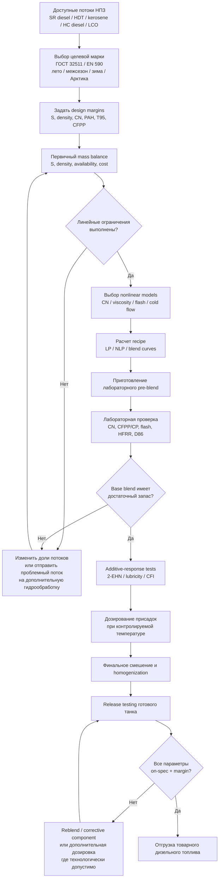

# Типовая логика блендинга товарного дизельного топлива на НПЗ

## Резюме для руководителя

Компаундирование товарного дизельного топлива на современном НПЗ — это не задача «смешать несколько фракций в заданной пропорции», а задача **многопараметрической оптимизации с обязательной лабораторной верификацией**. Для большинства товарных дизелей базовый пул формируют гидроочищенные прямогонные средние дистилляты; керосиновая фракция служит прежде всего инструментом управления низкотемпературными свойствами и вязкостью; FCC light cycle oil (LCO) без глубокой гидрообработки является проблемным компонентом из-за высокой плотности, ароматичности и плохой воспламеняемости; vacuum gas oil (VGO) обычно вообще **не является непосредственным компонентом товарного автомобильного дизеля**, а служит сырьем FCC/гидрокрекинга, после которого уже образуются пригодные дизельные фракции. Для низкосернистого дорожного дизеля доля сырого LCO и необессеренного straight-run gas oil практически ограничивается не каким-либо формальным процентом в стандарте, а балансом серы, плотности, цетанового числа, полиароматики и дистилляции. citeturn38search5turn38search13turn38search16

Ключевой нормативный вывод: **ГОСТ 32511-2013 и EN 590 регламентируют свойства готового топлива, а не рецептуру большинства нефтяных компонентов**. В ГОСТ 32511 для базового дизельного топлива установлены, в частности, цетановое число не ниже 51, цетановый индекс не ниже 46, плотность при 15 °C 820–845 кг/м³, полициклическая ароматика не более 8 % масс., сера для К5 не более 10 мг/кг, температура вспышки выше 55 °C, вязкость при 40 °C 2,0–4,5 мм²/с и T95 не выше 360 °C. Нормативное ограничение непосредственно на компонент есть, например, для FAME — не более 7 % об. В стандарте разрешено использование присадок, но металлосодержащие присадки, за исключением антистатических, запрещены. citeturn27view0turn27view4

Низкотемпературные свойства требуют особого отношения. Для летних/межсезонных сортов ГОСТ задает CFPP от +5 до −20 °C в зависимости от сорта A–F; для зимних и арктического классов 0–4 CFPP составляет соответственно −20, −26, −32, −38 и −44 °C, а температура помутнения — −10, −16, −22, −28 и −34 °C. **Pour point (температура застывания) при этом не является основным приемочным показателем ГОСТ 32511/EN 590 для автомобильного дизеля**: технологически важнее cloud point и особенно CFPP. citeturn27view2turn27view3

С точки зрения моделирования свойства разделяются на три класса. Сера, концентрация присадки и, с оговорками, массовая доля определенной группы ароматических соединений подчиняются материальному балансу. Плотность хорошо считается через аддитивность объемов. Вязкость уже требует логарифмического или viscosity-blending-index подхода. Цетановое число допускает локальные эмпирические blend indices, но универсальной линейной зависимости для произвольных потоков и особенно для 2-EHN нет. Cloud point, CFPP, pour point, flash point и HFRR — наиболее опасные для простого усреднения показатели: окончательное решение по ним должно приниматься после blend study и лабораторного анализа. Практика производителей топливных присадок прямо подчеркивает необходимость тестирования конкретного base fuel, особенно для cold-flow и lubricity packages. citeturn13search0turn13search3turn13search6

Наконец, заданных пользователем индивидуальных ограничений на рецептуру — например, «LCO не более 10 %» или «керосин минимум 15 %» — **нет**. Поэтому ниже такие ограничения не принимаются. Там, где приведены ориентировочные рабочие диапазоны компонентов, это **не норматив ГОСТ/EN 590**, а инженерный диапазон, который должен заменяться фактическими assay потоков конкретного НПЗ.

## Нормативная рамка и ограничения готового дизельного топлива

На территории РФ ключевой продуктовый стандарт — ГОСТ 32511-2013 «Топливо дизельное ЕВРО. Технические условия». Росстандарт показывает стандарт как действующий; он был введен как национальный стандарт РФ с 1 января 2015 года и является модифицированным относительно EN 590. Технический регламент ТР ТС 013/2011 остается базовым наднациональным документом ЕАЭС по безопасности автомобильного дизельного топлива. citeturn26search2turn26search0turn39search7

Для ЕС применима серия EN 590; в каталогах национальных имплементаций доступна редакция EN 590:2022. Европейский мониторинг качества топлива также использует EN 590 для контроля, в частности, цетанового числа, плотности и содержания серы. citeturn40search0turn28search2

### Базовые требования к товарному топливу

| Показатель | ГОСТ 32511-2013, базовый летний/межсезонный дизель | EN 590, типовая европейская спецификация | Значение для блендинга |
|---|---:|---:|---|
| Цетановое число | ≥ 51,0 | ≥ 51 | LCO и некоторые керосиновые потоки создают дефицит CN; hydrocracked/paraffinic stocks дают запас |
| Расчетный цетановый индекс | ≥ 46,0 | ≥ 46 | Нельзя «исправить» индекс одной лишь цетаноповышающей присадкой |
| Плотность при 15 °C | 820–845 кг/м³ | обычно 820–845 кг/м³ | Ограничивает тяжелый LCO и слишком легкий керосин/HVO |
| Сера, К5 | ≤ 10 мг/кг | ≤ 10 мг/кг | Почти чистый массовый баланс; часто одно из наиболее жестких ограничений |
| Полициклические ароматические углеводороды | ≤ 8 % масс. | ≤ 8 % масс. | Ограничивает cracked stocks, особенно LCO |
| Вязкость при 40 °C | 2,000–4,500 мм²/с | 2,0–4,5 мм²/с | Керосин снижает, тяжелые дистилляты повышают |
| Flash point, закрытый тигель | >55 °C | ≥/около 55 °C в EN 590 | Керосин/легкие концы могут стать лимитирующими |
| Перегоняется при 250 °C | <65 % об. | аналогичное ограничение | Контролирует чрезмерно легкий состав |
| Перегоняется при 350 °C | ≥85 % об. | аналогичное ограничение | Ограничивает тяжелый хвост |
| T95 | ≤360 °C | ≤360 °C | Очень важное ограничение на тяжелый cracked/hydrocracked tail |
| FAME | ≤7 % об. | ≤7 % об. для B7 | Редкий пример прямо нормированной доли компонента |
| HFRR при 60 °C | ≤460 мкм | ≤460 мкм | ULSD после глубокой HDS часто требует lubricity additive |

Значения ГОСТ непосредственно приведены в таблице 1 стандарта; там же установлены методы определения — ISO 5165/ГОСТ 32508 для CN, ISO 3675/12185 для плотности, ISO 20846/20884 для серы, ISO 2719 для flash point, ISO 12156-1 для HFRR и ISO 3405/ГОСТ 2177 для дистилляции. citeturn27view0turn27view4

### Низкотемпературные классы

Для летних и межсезонных сортов A–F ГОСТ 32511 задает максимальный CFPP:

| Сорт | A | B | C | D | E | F |
|---|---:|---:|---:|---:|---:|---:|
| CFPP, °C, не выше | +5 | 0 | −5 | −10 | −15 | −20 |

Для зимнего/арктического дизеля:

| Класс | 0 | 1 | 2 | 3 | 4 |
|---|---:|---:|---:|---:|---:|
| CFPP, °C, не выше | −20 | −26 | −32 | −38 | −44 |
| Cloud point, °C, не выше | −10 | −16 | −22 | −28 | −34 |
| Плотность, кг/м³ | 800–845 | 800–845 | 800–840 | 800–840 | 800–840 |
| CN, не ниже | 49 | 49 | 48 | 47 | 47 |
| Cetane index, не ниже | 46 | 46 | 46 | 43 | 43 |
| Flash point, °C, не ниже | 55 | 55 | 40 | 30 | 30 |

Именно это объясняет, почему зимний дизель нельзя проектировать только по «летним» ограничениям: разрешается снижение плотности, вязкости и в некоторых классах цетанового числа и flash point, поскольку получение экстремально низких cold-flow temperatures требует более легких или депарафинизированных компонентов. citeturn27view1turn27view2

Отдельный методологический момент: **температура застывания/pour point не должна подменять CFPP**. Депрессор может заметно изменить pour point и CFPP, не обязательно пропорционально изменяя cloud point, поскольку cloud point связан с началом образования кристаллов парафина, а CFPP — с прохождением топлива через стандартизованный фильтр. Поэтому для автомобильного дизеля blend optimization должен быть ориентирован на нормативный CFPP/cloud point, а pour point можно держать как дополнительный технологический KPI. citeturn27view2turn13search6

## Компоненты дизельного пула и типовая логика их использования

Терминология заслуживает уточнения. Для минеральной прямогонной дизельной фракции правильнее говорить **hydrotreated diesel / HDS / HDT**: гидрообессеривание, гидрирование и гидроденитрирование. Аббревиатура **HDO** строго означает hydrodeoxygenation и особенно характерна для переработки кислородсодержащего возобновляемого сырья. Ниже под «HDO/HDT» имеется в виду запрошенный пользователем гидроочищенный дизельный компонент; для обычного нефтяного НПЗ точнее HDT/HDS. Гидропроцессы действительно снижают серу вплоть до единиц mg/kg и одновременно меняют ароматичность и ignition quality. citeturn31search0turn38search16

### Сравнение основных компонентов

Числа в следующей таблице — **ориентиры для screening-модели, а не паспортные или нормативные диапазоны**. Реальные значения зависят от нефти, cut points, severity HDS, dewaxing и схемы НПЗ; поэтому assay конкретного потока имеет приоритет. Для LCO надежнее ориентироваться на реальные лабораторные данные: в одном промышленно ориентированном hydroprocessing-патенте исходный LCO характеризуется плотностью >890 кг/м³, PAH >25 % масс. и азотом >300 ppm, тогда как после глубокой обработки дизельная фракция может быть доведена примерно до ≤870 кг/м³ и существенно более низких серы/ароматики. citeturn38search5

| Компонент | Происхождение / состав | Ориентир плотности 15 °C, кг/м³ | Сера | Ориентир CN | Cloud point | Типичная роль / ограничение |
|---|---|---:|---|---:|---|---|
| Straight-run diesel / SRGO | Атмосферная перегонка; парафины, нафтены, ароматика | ~830–860 | От десятков до тысяч mg/kg до HDS; **не задано универсально** | ~45–60 | Очень зависит от n-парафинов; примерно от отрицательных до положительных °C | Хороший выход и CN, но raw stream обычно ограничивается серой и cold flow |
| Hydrotreated diesel, HDS/HDT | Гидроочищенный SRGO и/или смешанное middle-distillate feed | ~820–845 | Для компонента, предназначенного под К5/EN590, часто несколько mg/kg | ~50–60 | Сильно зависит от feed/dewaxing | Обычно основной «скелет» дизельного пула |
| Kerosene / hydrotreated kerosene | Более легкая среднедистиллятная фракция | ~780–820 | После HDS может быть единицы mg/kg | часто ниже хорошего SR diesel, ориентировочно ~40–50 | Обычно существенно ниже diesel cut | Снижает CFPP/cloud point и вязкость; может ухудшить flash point, density, lubricity |
| FCC LCO, raw | Ароматичный middle-distillate product FCC | часто >890 | Очень зависит от FCC feed; raw LCO не следует считать ULSD-компонентом | часто ~20–35 | **Не задано; assay обязателен** | Высокие density/PAH, низкий CN; для EN590/K5 обычно требует HDS/HDA/hydrocracking |
| Hydrotreated / upgraded LCO | Гидрированный LCO | примерно 850–875 в зависимости от severity | от десятков до <10 mg/kg при достаточно глубокой обработке | примерно ~35–50 | **Не задано универсально** | Может войти в diesel pool, но часто лимитируется CN, density и PAH |
| Hydrocracked diesel | Продукт hydrocracker из VGO/другого тяжелого feed | обычно легче и парафинистее LCO | обычно очень низкая после hydroprocessing | как правило высокий | Хороший после suitable dewaxing | «Корректирующий» высококачественный компонент |
| VGO | Vacuum gas oil, тяжелое сырье | существенно тяжелее товарного дизеля | зависит от crude | для прямого blending не является релевантным KPI | не релевантно | **Прямой компонент автомобильного дизеля обычно 0 %; feed FCC/hydrocracker** |
| FAME | Метиловые эфиры жирных кислот | обычно выше mineral diesel | низкая | зависит от feedstock | зависит от состава | Нормативно до 7 % об. для B7 |
| Cetane improver, обычно 2-EHN | Нитратный ignition improver | дозировка ppm | — | Повышает measured CN | практически не основной cold-flow lever | Нелинейный, насыщаемый response |
| Lubricity additive | Fatty-acid/ester-type surface-active chemistry | дозировка ppm | — | — | — | Снижает HFRR wear scar |
| Depressant / CFPP improver | Полимерный модификатор кристаллизации воска | дозировка ppm | — | — | Может почти не менять CP, но улучшать CFPP/PP | Работает только на совместимой wax distribution |
| Cold-flow package | CFI + wax dispersant и др. | дозировка ppm | — | — | Fuel-specific | Дозировка определяется blend-response test |

Качественный вывод по LCO хорошо подтверждается технологической литературой: производители hydroprocessing catalysts отдельно выделяют Diesel/LCO hydrotreating как задачу одновременного глубокого desulfurization, aromatics saturation и cetane improvement. В процессе гидроапгрейдинга LCO исходный тяжелый и полиароматический поток превращается в значительно более приемлемый diesel-range product. citeturn38search5turn38search16

Для керосина логика противоположна. Его традиционно используют для улучшения cold-flow behaviour дизеля; современная практика также подтверждает, что увеличение kerosene content может улучшать низкотемпературные показатели, но меняет lubricity и поэтому иногда требует пересмотра lubricity-additive dose. citeturn7search0turn13search3

### Реальные ограничения долей компонентов

**Универсальных нормативных долей straight-run diesel, HDT, kerosene или LCO в ГОСТ 32511/EN 590 нет.** Состав устанавливается так, чтобы готовая смесь удовлетворяла всем параметрам. Единственная из перечисленных крупных blending streams с явным лимитом в рассмотренном стандарте — FAME, ≤7 % об. citeturn27view0

Поэтому инженерно корректнее задавать ограничения так:

\[
x_i^{min}\le x_i\le x_i^{max},
\qquad \sum_i x_i=1
\]

где \(x_i^{max}\) определяется самой жесткой из property constraints.

Например, если необработанный straight-run component содержит 500 mg/kg S, а основа HDT — 5 mg/kg, то для К5:

\[
500x+5(1-x)\le 10
\]

\[
x\le \frac{10-5}{500-5}=0.0101
\]

То есть **всего около 1,0 % масс.** такого сырого компонента можно было бы математически допустить по сере — еще до проверки CN, density и остальных параметров. Это иллюстрирует, почему на К5 исходный straight-run diesel практически всегда идет сначала на hydrotreater.

Для LCO можно аналогично получить ограничение от плотности. Пусть:

\[
\rho_{HDT}=835,\qquad \rho_{LCO}=900\ {\rm kg/m^3}.
\]

При идеальной аддитивности объемов и массовой доле LCO \(x\):

\[
\frac{1}{\rho_b}=
\frac{x}{900}+
\frac{1-x}{835}.
\]

Требуя \(\rho_b\le845\), получаем приблизительно:

\[
x_{LCO}\lesssim 16\%.
\]

Если одновременно принять CN(HDT)=54 и CN(raw LCO)=30, даже простая предварительная линейная оценка:

\[
54(1-x)+30x\ge51
\]

дает:

\[
x\le12.5\%.
\]

А PAH или фактическая нелинейность ignition quality способны сделать допустимую долю еще меньше. Именно поэтому для автомобильного ULSD разумно мыслить не правилом «LCO = 10 %», а **пересечением ограничений density–CN–PAH–sulfur–distillation**. Исходные неблагоприятные характеристики LCO подтверждаются промышленными данными по его hydroprocessing. citeturn38search5turn38search13

Практический screening envelope можно сформулировать так: HDT/hydrocracked diesel обычно является основным компонентом; керосин может переходить от почти нуля летом к заметной доле зимой; raw LCO для К5/EN590 чаще должен быть нулевым или очень небольшим, тогда как глубоко hydrotreated LCO допускает значительно большую долю; VGO непосредственно в final road-diesel blend обычно не вводится. **Численные границы этих долей следует оптимизировать по assay — они не задаются стандартом.**

## Аддитивность свойств и математические модели блендинга

Главная ошибка упрощенной модели НПЗ — считать, что любое свойство топлива можно получить как:

\[
P_b=\sum_i x_iP_i.
\]

Это справедливо лишь для ограниченного класса величин.

### Почти аддитивные свойства

Для **массовой доли серы** при отсутствии химической реакции:

\[
S_b=\sum_i w_iS_i.
\]

Это фактически материальный баланс. Та же логика применима к дозировке присадки и, при совместимых определениях анализа, к массовой концентрации химической группы:

\[
C_b=\sum_i w_iC_i.
\]

Отсюда удобно рассчитывать максимальную долю высокосернистого компонента:

\[
w_j^{max}
=
\frac{S_{spec}-S_{clean}}
{S_j-S_{clean}}.
\]

Для **плотности** более физически корректна аддитивность объемов. При массовых долях:

\[
\boxed{
\rho_b
\approx
\left(
\sum_i \frac{w_i}{\rho_i}
\right)^{-1}
}
\]

если объемное сокращение при смешении несущественно. При известных объемных долях \(\phi_i\):

\[
\boxed{
\rho_b\approx\sum_i\phi_i\rho_i
}
\]

при одинаковой reference temperature.

### Kay's mixing rule и предел его применения

Запрошенное правило Kay в общем виде представляет линейное смешение pseudo-properties:

\[
P_{mix}\approx\sum_i y_iP_i.
\]

Классическое применение Kay's rule — прежде всего расчет pseudocritical properties многокомпонентных углеводородных систем. Использовать его как универсальный закон блендинга товарного дизеля неправильно. В контексте refinery blending это скорее напоминание о классе **linear pseudo-property rules**: они подходят для первичного screening аддитивных величин, но не должны переноситься на cloud point, CFPP, flash point, lubricity или эффект 2-EHN.

### Вязкость

Простое:

\[
\nu_b=\sum x_i\nu_i
\]

обычно систематически хуже, чем логарифмическое смешение. Для ограниченного диапазона компонентов используют:

\[
\boxed{
\ln \nu_b \approx \sum_i x_i\ln\nu_i
}
\]

или промышленный **Refutas viscosity blending number**:

\[
VBN_i
=
14.534\ln[\ln(\nu_i+0.8)]+10.975
\]

\[
VBN_b=\sum_i x_iVBN_i
\]

и обратное преобразование:

\[
\boxed{
\nu_b=
\exp\left[
\exp\left(
\frac{VBN_b-10.975}{14.534}
\right)
\right]-0.8
}
\]

где \(\nu\) обычно выражается в cSt/мм²·с при одной температуре. Это **эмпирический blending index**, а не фундаментальный закон; его следует калибровать на используемый набор потоков.

### Цетановое число

Цетановое число принципиально сложнее серы. Для близких по природе straight-run/hydrotreated streams линейная интерполяция может быть приемлемым first guess:

\[
CN_b^{(0)}=\sum_i x_i CN_i.
\]

Но для LCO, paraffinic hydrocracker product, HVO/GTL и особенно при введении ignition improver лучше использовать преобразованный blending index:

\[
I_i=f(CN_i),
\]

\[
I_b=\sum_i x_i I_i,
\]

\[
\boxed{CN_b=f^{-1}(I_b)}
\]

либо регрессионную модель:

\[
CN_b=
\beta_0+
\sum_i\beta_i x_i+
\sum_{i<j}\beta_{ij}x_ix_j+
\sum_i\beta_{ii}x_i^2.
\]

Отдельно важно различать **cetane number и calculated cetane index**. ГОСТ требует оба параметра. Cetane index рассчитывается по density/distillation characteristics; поэтому повышение фактического CN нитратной присадкой не превращает плохой base fuel в продукт с соответствующим расчетным индексом. Именно поэтому норматив содержит две независимые строки — CN ≥51 и CI ≥46. citeturn27view1

Для 2-EHN хорошо подходит насыщаемая эмпирическая зависимость:

\[
\boxed{
\Delta CN=A
\left(1-e^{-kd}\right)
}
\]

где \(d\) — dose, а \(A,k\) определяются bottle test/plant data. Линейно экстраполировать response при больших дозах не следует. Патентная техническая литература показывает очень широкий практически используемый диапазон 2-EHN порядка сотен–тысяч ppm, что само по себе подчеркивает зависимость dose-response от base fuel. citeturn35search0

### Cloud point, CFPP и pour point

Эти свойства определяются появлением и развитием сети кристаллов n-paraffins. Поэтому математически среднее между, например, +5 и −40 °C **не обязано быть cloud point реальной смеси**.

Для планирования применяют:

\[
CP_b = f(x_1,\ldots,x_n,T_{90},T_{95},
n{\rm -paraffins},wax,\rho,\ldots)
\]

или локальную регрессию:

\[
CP_b=
\beta_0+\sum_i\beta_ix_i+
\sum_{i<j}\beta_{ij}x_ix_j.
\]

Практически лучший способ — **property blending curve**, полученная из серии лабораторных смесей, например 0/5/10/15/20 % kerosene или LCO.

Cold-flow improver добавляет еще одну переменную:

\[
CFPP =
f(\mathbf{x},d_{CFI},T_{dose},mixing).
\]

Производители присадок прямо рассматривают blending и cold-flow additives как взаимодополняющие инструменты получения зимнего топлива. citeturn13search6

### Сводная таблица моделей

| Свойство | Рекомендуемая first-principles / engineering модель | Формула | Применимость | Основное ограничение |
|---|---|---|---|---|
| Сера | Массовый баланс | \(S=\sum w_iS_i\) | Очень высокая | Нужны корректные mass fractions |
| Плотность | Аддитивность объемов | \(1/\rho=\sum w_i/\rho_i\) | Высокая | Небольшая volume contraction обычно игнорируется |
| Концентрация присадки | Массовый баланс | \(C=\sum w_iC_i\) | Высокая | Эффект присадки не аддитивен |
| PAH / состав | Массовый баланс как first guess | \(A=\sum w_iA_i\) | Хорошая при одинаковой аналитической базе | Не моделирует upstream hydrogenation |
| Вязкость | Refutas/VBN или log rule | \(\ln\nu=\sum x_i\ln\nu_i\) | Хорошая для близких petroleum stocks | Требует одной температуры; крайние смеси надо проверять |
| Cetane number | Blend index / empirical regression | \(CN=f^{-1}[\sum x_if(CN_i)]\) | Средняя–высокая после calibration | Нет универсальной функции для любых stocks |
| Cetane-improver response | Saturating dose-response | \(\Delta CN=A(1-e^{-kd})\) | После bottle-test calibration | Fuel-specific |
| Cetane index | EN ISO 4264-type calculation | \(CI=f(\rho,T_{10},T_{50},T_{90})\) | Для unadditized hydrocarbon fuel | Не дает credit за 2-EHN |
| Cloud point | Regression / blending curve | \(CP=f(\mathbf{x})\) | Только локально | Сильно нелинеен |
| CFPP | Blend curve + additive response | \(CFPP=f(\mathbf{x},d,T)\) | Локально | Очень зависит от wax distribution и CFI chemistry |
| Pour point | Regression / lab | \(PP=f(\mathbf{x},d)\) | Secondary KPI | Не заменяет CFPP |
| Flash point | Vapor-liquid empirical model + lab | \(FP=f(x_i,P_i^{vap})\) | Screening | Простое усреднение температур неверно |
| Distillation | Pseudo-component / cumulative curve model | \(V(T)=\sum\phi_iV_i(T)\) как approximation | Хорошо для planning | Финальный D86/ISO 3405 обязателен |
| HFRR lubricity | Dose-response / regression | \(HFRR=f(\mathbf{x},d_{LA})\) | После calibration | Сильно нелинейная поверхностная химия |

На практике LP удобно применять к сере, cost, availability и другим линейным ограничениям; нелинейные CN/cold-flow/flash-point correlations переводят задачу в NLP либо аппроксимируют piecewise-linear constraints для MILP. Современные исследования online refinery blending также рассматривают model mismatch и нелинейные property responses как одну из ключевых проблем замкнутой оптимизации. citeturn25academia2

## Практическая стратегия НПЗ, контроль качества и работа с нелинейностью

### Как обычно строится recipe

Начинать следует не с процентов компонентов, а с **product target with giveaway margins**. Если спецификация по сере 10 mg/kg, оператор редко проектирует расчетную смесь ровно 10.00 mg/kg: оставляется запас на аналитическую воспроизводимость, variability компонентов, tank heel, line displacement и blending error. Та же логика относится к density, CN, CFPP и T95.

На уровне screening сначала фиксируются «жесткие» потоки: availability HDT/hydrocracker diesel, обязательное вовлечение cracked stock, tank inventory. Затем по почти линейным показателям быстро отбрасываются невозможные recipes:

\[
\begin{aligned}
&\sum_i x_i=1,\\
&S(\mathbf{x})\le S_{target},\\
&\rho_{min}\le\rho(\mathbf{x})\le\rho_{max},\\
&PAH(\mathbf{x})\le PAH_{max},\\
&x_i^{min}\le x_i\le x_i^{max}.
\end{aligned}
\]

После этого проверяются nonlinear constraints — viscosity, CN, distillation, flash point, CFPP/cloud point.

### Роль керосина

Kerosene cut — один из самых простых способов улучшить winter operability, но это не «бесплатное» улучшение. При увеличении керосина одновременно:

\[
\rho\downarrow,\quad
\nu\downarrow,\quad
T_{flash}\downarrow,
\]

как правило улучшаются cold-flow characteristics, но может снижаться lubricity reserve. Поэтому winterization нельзя оптимизировать только по CFPP. Практические исследования Infineum прямо показывают связь увеличения керосиновой доли с необходимостью вновь оценивать lubricity/additive response. citeturn13search0turn13search3

### Роль LCO

Raw FCC LCO следует считать **penalty stream**, пока лабораторные данные не докажут обратное. Типичные penalties: высокая density, высокая aromaticity/PAH, низкий CN и часто высокая sulfur load. Его экономическая привлекательность возникает потому, что вовлечение LCO увеличивает diesel pool, но требует либо более качественных компенсирующих streams, либо hydroprocessing. Технологии LCO hydrotreating/hydrocracking специально нацелены на sulfur removal, aromatic saturation и cetane upgrading. citeturn38search5turn38search13turn38search16

Практически это означает: сначала максимально выгодно решить проблему LCO **в установке гидропроцессинга**, а не пытаться «спрятать» плохой raw LCO в товарном tank blend.

### Присадки

**Cetane improver.** 2-EHN применяют после того, как base blend уже удовлетворяет свойствам, которые эта присадка не способна исправить: sulfur, density, PAH, distillation и calculated cetane index. Dose определяется CN-response curve, а не линейным правилом ppm → CN. citeturn35search0

**Lubricity additive.** Глубокая hydrotreatment удаляет не только sulfur compounds, но и ряд естественно поверхностно-активных соединений. Поэтому ULSD требует контроля HFRR, а дозировка lubricity additive может составлять порядка десятков–сотен ppm в зависимости от chemistry и base fuel; в опубликованном исследовательском примере коммерческие lubricity additives испытывались при 150 ppmw. citeturn35search1turn13search5

**Depressant/CFI.** Здесь концентрация сама по себе почти ничего не гарантирует: эффективная chemistry определяется distribution n-paraffins, end point, kerosene dilution и историей охлаждения. По этой причине дозировку выбирают по серии blend-response tests. citeturn13search6

### Температура и порядок ввода

Cold-flow additive должен быть введен в достаточно теплое, полностью жидкое топливо **до формирования восковой кристаллической структуры**, после чего необходимо обеспечить хорошее смешение. На практике плохой temperature control способен превратить правильную дозировку CFI в неэффективную. Поэтому в blend procedure должны задаваться minimum dosing temperature, mixing time и sample conditioning protocol; конкретные значения зависят от используемой chemistry и инструкции поставщика присадки. citeturn13search6

При работе с очень малыми расходами присадки также целесообразна controlled injection или предварительное разбавление/carrier stream: иначе concentration averaging в танке может быть хуже, чем точность самой лабораторной модели.

### Контроль качества

Для окончательного release товарного дизеля наиболее важны:

| Показатель | Типовой нормативный метод / семейство методов |
|---|---|
| Плотность | ISO 3675 / ISO 12185 |
| Сера | ISO 20846 / ISO 20884 |
| Цетановое число | ISO 5165 / EN 15195 и эквивалентные |
| Цетановый индекс | ISO 4264 family |
| Вязкость | ГОСТ 33 / соответствующие ISO методы |
| Flash point | ISO 2719, closed cup |
| Distillation | ISO 3405 / ГОСТ 2177 |
| CFPP | EN 116 / ГОСТ 22254 |
| Cloud point | предусмотренный стандартом метод / ГОСТ 5066 |
| PAH | EN 12916 |
| HFRR lubricity | ISO 12156-1 |
| FAME | EN 14078 |

Эти методы прямо перечисляются ГОСТ 32511 как методы подтверждения соответствующих требований. citeturn27view0turn27view2turn27view4

### Логика принятия решения

## Расчет трех гипотетических блендов

Ниже приведены **не рецептуры реального НПЗ**, а демонстрация вычислительной логики. Исходные свойства специально заданы условно, чтобы показать работу разных моделей. Их нельзя использовать вместо фактических assay.

### Условные свойства расчетных компонентов

| Компонент | Плотность, кг/м³ | S, mg/kg | CN | Cloud point, °C |
|---|---:|---:|---:|---:|
| HDT diesel | 835 | 5 | 54 | −8 |
| Low-S straight-run / mildly treated diesel | 842 | 18 | 52 | +2 |
| Hydrotreated kerosene | 800 | 3 | 46 | −40 |
| Upgraded LCO | 865 | 8 | 42 | −18 |

Важно: даже строка «low-S straight-run» с 18 mg/kg sulfur **сама по себе не является К5**, но небольшая доля может войти в общий blend, если материальный баланс дает ≤10 mg/kg и все остальные параметры проходят. Это и есть отличие component specification от finished-product specification.

### Выбранные расчетные модели

Для density:

\[
\rho_b=
\left(\sum_i\frac{w_i}{\rho_i}\right)^{-1}.
\]

Для sulfur:

\[
S_b=\sum_iw_iS_i.
\]

Для CN в демонстрационном примере используется условный нелинейный blending index:

\[
I_{CN}=CN^{1.5},
\]

\[
CN_{base}=
\left(
\sum_iw_i CN_i^{1.5}
\right)^{1/1.5}.
\]

**Показатель 1.5 здесь не является универсальным отраслевым коэффициентом**; он условно имитирует refinery-calibrated blending index. На реальном НПЗ показатель или вся функция \(f(CN)\) определяются историческими blend data.

Для 2-EHN в примере:

\[
\Delta CN=
4.5\left(1-e^{-d/500}\right),
\]

где \(d\) — ppm 2-EHN. Это также **демонстрационная calibration curve**, а не product guarantee.

Для cloud point, поскольку универсального закона смешения нет, используется условный nonlinear index:

\[
I_{CP}=(CP+60)^4,
\]

\[
CP_b=
\left[
\sum_iw_i(CP_i+60)^4
\right]^{1/4}-60+\Delta CP_{CFI}.
\]

Степень 4 выбрана лишь для иллюстрации того, что более «теплый», waxy component влияет сильнее линейного среднего. В реальном blend model она заменяется regression/blending curve, построенной по лаборатории.

### Бленд A — условный летний К5

Состав:

\[
70\%\,HDT+
25\%\,SRD+
5\%\,kerosene.
\]

**Плотность**

\[
\rho=
\left(
\frac{0.70}{835}
+\frac{0.25}{842}
+\frac{0.05}{800}
\right)^{-1}
\]

\[
\boxed{\rho\approx834.9\ {\rm kg/m^3}}
\]

то есть расчетно внутри 820–845 кг/м³. citeturn27view0

**Сера**

\[
S=
0.70(5)+0.25(18)+0.05(3)
\]

\[
S=3.50+4.50+0.15
\]

\[
\boxed{S=8.15\ {\rm mg/kg}}
\]

то есть расчетно ниже К5 limit 10 mg/kg. citeturn27view0

**Цетановое число**

\[
CN=
\left[
0.70(54^{1.5})+
0.25(52^{1.5})+
0.05(46^{1.5})
\right]^{2/3}
\]

\[
\boxed{CN\approx53.1}
\]

— выше нормативного 51. citeturn27view1

**Cloud point**

\[
CP\approx -5.5^\circ C.
\]

Для летнего/межсезонного продукта сам cloud point не является тем же самым нормативным ограничением, что CFPP; поэтому из результата **нельзя автоматически заключить**, что сорт C или D пройден. Нужен EN 116/ГОСТ 22254 CFPP test. citeturn27view3

**Интерпретация:** blend выглядит правдоподобным по density/S/CN, но sulfur margin всего 1.85 mg/kg. Если feed sulfur меняется, recipe слишком близок к limit. Производственно разумнее либо уменьшить SRD, либо использовать более глубоко hydrotreated SRD.

### Бленд B — зимний, с керосином и upgraded LCO

Состав:

\[
65\%\,HDT+
25\%\,kerosene+
10\%\,upgraded\ LCO.
\]

Дополнительно условно вводятся:

\[
d_{2EHN}=400\ ppm,
\qquad
\Delta CP_{CFI}=-4^\circ C.
\]

**Плотность**

\[
\rho=
\left(
\frac{0.65}{835}
+\frac{0.25}{800}
+\frac{0.10}{865}
\right)^{-1}
\]

\[
\boxed{\rho\approx828.8\ {\rm kg/m^3}}
\]

**Сера**

\[
S=
0.65(5)+0.25(3)+0.10(8)
\]

\[
\boxed{S=4.80\ {\rm mg/kg}}
\]

**Базовое CN** по nonlinear index получается около:

\[
CN_{base}\approx50.9.
\]

Эффект условных 400 ppm 2-EHN:

\[
\Delta CN=
4.5(1-e^{-400/500})
\approx2.48.
\]

Следовательно,

\[
\boxed{CN_{final}\approx53.4}.
\]

То есть пример специально показывает, почему 2-EHN может быть экономичнее дальнейшего уменьшения LCO, **если** calculated cetane index и прочие параметры base blend уже удовлетворительны.

**Cloud point**

После nonlinear blending и условного действия CFI:

\[
\boxed{CP\approx-16.5^\circ C}.
\]

Это примерно соответствует cloud-point severity зимнего класса 1 по ГОСТ (−16 °C), но **не доказывает CFPP −26 °C**. Для class 1 обязательна отдельная лабораторная проверка CFPP ≤−26 °C. citeturn27view2

Таким образом, даже при очень хорошем расчетном sulfur margin этот blend может быть отклонен именно по CFPP.

### Бленд C — повышенное вовлечение cracked stock

Состав:

\[
68\%\,HDT+
10\%\,SRD+
7\%\,kerosene+
15\%\,upgraded\ LCO.
\]

Условно:

\[
d_{2EHN}=800\ ppm,
\qquad
\Delta CP_{CFI}=-3^\circ C.
\]

**Плотность**

\[
\boxed{\rho\approx837.5\ {\rm kg/m^3}}.
\]

Несмотря на 15 % тяжелого LCO, керосин и HDT удерживают density в specification window.

**Сера**

\[
S=
0.68(5)+0.10(18)+0.07(3)+0.15(8)
\]

\[
=3.40+1.80+0.21+1.20
\]

\[
\boxed{S=6.61\ {\rm mg/kg}}.
\]

**Цетановое число**

Нелинейный base-stock index плюс условная saturated response 800 ppm 2-EHN дает:

\[
\boxed{CN_{final}\approx55.1}.
\]

Однако столь хороший final CN **не означает**, что blend автоматически пройдет cetane index ≥46: присадка повышает measured ignition quality, но расчетный CI по density/distillation должен быть проверен независимо. Требование ГОСТ к этим двум параметрам раздельное. citeturn27view1

**Cloud point**

\[
\boxed{CP\approx-11.7^\circ C}.
\]

Это демонстрирует важный нелинейный trade-off: несмотря на 7 % очень холодного керосина и CFI, сравнительно «теплый» HDT/SRD matrix может не дать глубокого winter grade. В реальном проекте возможны четыре хода: увеличить low-cloud kerosene/hydrocracked component, использовать dewaxed diesel, подобрать более эффективный CFI по response curve либо снизить долю waxy component.

### Итог расчета

| Blend | Состав, масс. % | Density, кг/м³ | S, mg/kg | Predicted CN | Predicted cloud point, °C | Предварительная оценка |
|---|---|---:|---:|---:|---:|---|
| A | HDT 70 / SRD 25 / Kero 5 | 834.9 | 8.15 | 53.1 | −5.5 | Летний base blend выглядит реалистично; sulfur margin невелик |
| B | HDT 65 / Kero 25 / HT-LCO 10 + 400 ppm 2-EHN + CFI | 828.8 | 4.80 | 53.4 | −16.5 | Хороший зимний candidate, но CFPP test обязателен |
| C | HDT 68 / SRD 10 / Kero 7 / HT-LCO 15 + 800 ppm 2-EHN + CFI | 837.5 | 6.61 | 55.1 | −11.7 | Density/S/CN проходят расчетно; cold-flow становится bottleneck |

Все три примера намеренно показывают главное правило refinery blending: **результат определяется не «средним качеством», а наиболее жестким активным ограничением**.

## Инженерные выводы и рекомендуемая архитектура модели

Для практической системы blending optimization целесообразно разделить свойства на уровни.

**Первый уровень — материальный баланс.** Sulfur, additive concentration, availability, tank inventory, массовый PAH screening. Такие ограничения следует включать непосредственно в LP.

**Второй уровень — хорошо моделируемые физические свойства.** Density через volume additivity; viscosity через Refutas/logarithmic index; distillation через assay curves/pseudocomponents.

**Третий уровень — эмпирические свойства.** Cetane number, flash point и особенно cloud point/CFPP. Они должны быть основаны на historical laboratory blends или специальном design of experiments.

**Четвертый уровень — additives.** 2-EHN, lubricity improver и CFI не следует рассматривать как эквивалент bulk blending streams. Их response curves нелинейны, могут взаимодействовать с fuel composition и требуют отдельной calibration.

В математической форме refinery optimizer можно представить:

\[
\min_{\mathbf{x},\mathbf{d}}
\left[
\sum_i c_ix_i+
\sum_k c_k^{add}d_k+
penalty(giveaway)
\right]
\]

при:

\[
\sum_i x_i=1,
\]

\[
x_i^{min}\le x_i\le x_i^{max},
\]

\[
S(\mathbf{x})\le S_{target},
\]

\[
\rho_{min}\le\rho(\mathbf{x})\le\rho_{max},
\]

\[
CN(\mathbf{x},d_{CI})\ge CN_{target},
\]

\[
CFPP(\mathbf{x},d_{CFI})\le CFPP_{target},
\]

\[
HFRR(\mathbf{x},d_{LA})\le460,
\]

а также ограничениями flash point, PAH, viscosity и D86/ISO 3405 curve. Нелинейные свойства либо решаются NLP, либо аппроксимируются piecewise-linear envelopes.

Для конкретного НПЗ наиболее ценная модель, как правило, строится не из «универсальных справочных свойств», а из базы данных вида:

\[
\{\text{component assays}\}
+
\{\text{blend recipes}\}
+
\{\text{laboratory results}\}
+
\{\text{additive doses}\}
+
\{\text{temperature/history}\}.
\]

На ней можно оценить:

\[
P_j=
\beta_{0,j}
+\sum_i\beta_{i,j}x_i
+\sum_{i<k}\beta_{ik,j}x_ix_k
+\sum_m\gamma_{m,j}d_m
+\sum_m\delta_{m,j}d_m^2.
\]

Именно interaction terms \(x_ix_k\) и nonlinear additive terms позволяют уловить то, что простой weighted average пропускает.

С практической точки зрения наиболее важны следующие правила.

Во-первых, **не использовать raw VGO как обычный diesel blendstock**: VGO должен быть превращен FCC/hydrocracker processing в middle-distillate product. Фактическая российская практика также показывает VGO именно как feed hydrocracker с производством low-sulfur diesel, а не как прямой товарный компонент. citeturn33news0

Во-вторых, **raw LCO сначала рассматривать как hydroprocessing feed**, а не как способ дешево увеличить diesel pool. Его density/aromaticity/cetane penalties хорошо документированы, а специализированные LCO upgrading processes существуют именно по этой причине. citeturn38search5turn38search13

В-третьих, **керосин — winter lever, а не универсальный quality improver**. За выигрыш в cold flow платят снижением density, viscosity/volumetric energy content, возможным снижением flash point и необходимостью повторной проверки lubricity. citeturn13search0turn13search3

В-четвертых, **не проектировать точно на нормативную границу**. Особенно это относится к sulfur 10 mg/kg, CN 51, density 845 kg/m³, HFRR 460 μm и CFPP климатического класса. Нужен технологический giveaway margin с учетом repeatability/reproducibility лаборатории и variability компонентов.

В-пятых, **не считать cold-flow properties аддитивными**. Это наиболее вероятное место, где spreadsheet-модель даст ошибочно оптимистичный результат. Производственная практика должна включать small-scale pre-blend, controlled cooling, CFPP/cloud-point test и CFI dose-response study. citeturn13search6

## Источниковая база и приоритет надежности

Основой численных нормативов настоящего отчета является **ГОСТ 32511-2013 с действующими изменениями и поправками**. Росстандарт подтверждает статус документа; полный доступный текст стандарта содержит таблицы product properties, climate grades, methods of test и требования к присадкам. citeturn26search2turn26search0turn27view0turn27view2

Для наднациональной нормативной рамки использован **ТР ТС 013/2011** на официальном ресурсе Евразийской экономической комиссии. Для европейской части — EN 590 и материалы европейского мониторинга качества топлива. citeturn39search7turn28search2turn40search0

Для технологической практики LCO использованы первичные промышленные материалы Honeywell UOP/Ketjen и патентные данные по hydroprocessing LCO. Они подтверждают, что LCO является сложным diesel blendstock и что глубокая hydrogenation/hydrocracking позволяет снизить density, sulfur и aromatics и улучшить пригодность к diesel pool. citeturn38search5turn38search13turn38search16

Для практики additive/cold-flow/lubricity использованы технические материалы Infineum и опубликованные патентные экспериментальные данные. Они особенно важны для вывода о fuel-specific response cold-flow и lubricity additives и о необходимости лабораторной оптимизации дозировки. citeturn13search0turn13search3turn13search6turn35search0turn35search1

Из классической нефтеперерабатывающей литературы методологически релевантны **API Technical Data Book — Petroleum Refining**, Gary, Handwerk & Kaiser, *Petroleum Refining: Technology and Economics*, а также справочники по petroleum product blending и refinery process design. Их роль — прежде всего density/volume balance, viscosity correlations, characterization of refinery streams и architecture of blend optimization. IEA-публикации полезны для анализа refinery configuration, diesel supply/demand и структуры нефтепереработки, но **не являются первичным источником продуктовых пределов EN 590/ГОСТ и поэтому не использовались здесь для назначения численных property constraints**.

Ключевой практический итог можно свести к одному принципу:

\[
\boxed{
\text{Оптимальный diesel blend}
=
\text{минимальная стоимость/максимальный выход}
\quad
\text{при запасе по каждому нормативному свойству}
}
\]

а не к фиксированной типовой рецептуре. Для sulfur и density расчет обычно очень надежен; для viscosity нужен blending index; для cetane — калиброванная nonlinear model; для cloud point/CFPP, flash point и lubricity **лабораторная проверка является частью самой модели, а не только финальным контролем качества**.