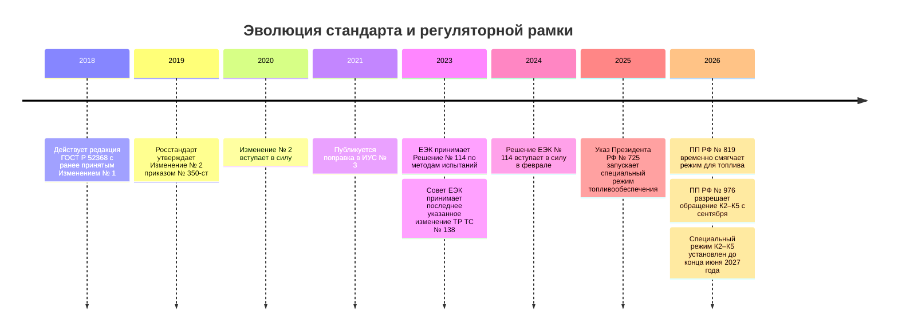

# Регулирование автомобильного дизельного топлива в России: ГОСТ Р и актуальный режим

## Резюме

По состоянию на **11 сентября 2026 года** требования к дизельному топливу, которое заявляется именно как соответствующее **ГОСТ Р 52368-2005 «Топливо дизельное ЕВРО. Технические условия»**, следует отделять от более широкого вопроса о том, какое топливо временно разрешено выпускать и продавать на российском рынке. Сам ГОСТ Р 52368 продолжает содержать собственные числовые нормы; последние содержательные изменения в нем — **Изменение № 2**, утвержденное приказом Росстандарта от 02.07.2019 № 350-ст и введенное с 01.01.2020, плюс последующая поправка, опубликованная в ИУС № 3 за 2021 год. Нового изменения ГОСТ Р 52368 в 2024–2026 годах в актуализированных источниках не выявлено. citeturn8view0turn6view0turn9search2

Для обычного топлива **К5 по ГОСТ Р 52368** ключевые нормы таковы: сера не более **10 мг/кг**; цетановое число для летнего/межсезонного топлива не менее **51**, для зимних классов — **49/49/48/47**, для арктического класса 4 — **47**; плотность летнего/межсезонного топлива **820,0–845,0 кг/м³ при 15 °C**, холодных классов — от **800,0 кг/м³** с верхним пределом 840 или 845 кг/м³; для стандартной фракционной характеристики отгон при 250 °C должен быть менее 65 % об., при 350 °C — не менее 85 % об., а **T95 ≤360 °C**. Для зимнего/арктического топлива применяется специальная фракционная характеристика: при 180 °C отгоняется не более 10 % об., при 340 °C — не менее 95 % об. citeturn19view0turn19view2turn18view1

Холоднотекучесть классифицируется гораздо детальнее, чем просто «летнее/зимнее»: летние сорта A–D имеют предельную температуру фильтруемости (CFPP) **+5/0/−5/−10 °C**, межсезонные E/F — **−15/−20 °C**, зимние классы 0–3 — **−20/−26/−32/−38 °C**, арктический класс 4 — **−44 °C**. Для классов 0–4 дополнительно нормируется температура помутнения: **−10/−16/−22/−28/−34 °C** соответственно. citeturn19view2turn18view1

Нормальная наднациональная рамка — ТР ТС 013/2011 — после завершения переходных сроков допускала в Российской Федерации фактически К5; приложение 3 устанавливает для К5 серу ≤10 мг/кг, цетановое число 51 для летнего и 47 для зимнего/арктического топлива, T95 ≤360 °C и климатические минимумы CFPP. citeturn16view0turn17view0turn17view1 **Однако в 2026 году действует чрезвычайное национальное исключение:** постановление Правительства РФ от 02.07.2026 № 819 временно допустило дизельное топливо, именуемое К5, с серой до **350 мг/кг** при неприменении части требований ТР ТС 013/2011; затем постановление Правительства РФ от 05.08.2026 № 976 расширило временный режим, и с 1 сентября 2026 года до 30 июня 2027 года на российских АЗС допускается обращение топлива экологических классов **К2, К3, К4 и К5**. Это **не изменение ГОСТ Р 52368**: топливо с S=350 мг/кг нельзя считать соответствующим ГОСТ Р 52368 как К5 только потому, что его обращение временно разрешено. citeturn32search1turn32search3turn34search0turn34search2

## Нормативная рамка и статус требований

ГОСТ Р 52368 устанавливает требования непосредственно к продукту: § 5.2 отсылает к таблице 2 с общими физико-химическими показателями, а § 5.3 — к таблицам 3 и 4 для климатических исполнений. Важный момент интерпретации: специальные значения таблицы 4 для зимних и арктических классов заменяют соответствующие общие климатически чувствительные значения таблицы 2 — иначе, например, одновременно требовались бы плотность минимум 820 кг/м³ и допускаемая таблицей 4 плотность 800 кг/м³. citeturn19view0turn19view2

ТР ТС 013/2011, напротив, является обязательным техническим регламентом обращения. Статья 4 требует доведения до потребителя наименования и марки топлива, включая экологический класс; статья 5 и приложение 3 задают обязательные показатели безопасности дизельного топлива; каждая партия сопровождается паспортом, где указываются нормативные и фактические результаты испытаний. До введения национальных исключений 2026 года статья 7.4 последовательно прекратила обращение в РФ К2, К3 и К4, оставив К5 без ограничения срока. citeturn15view1turn16view0

Евразийская экономическая комиссия на актуальной странице ТР ТС 013/2011 перечисляет изменения Совета ЕЭК № 43 от 2014 года, № 84 от 2015 года, № 108 от 2019 года и № 138 от 2023 года; нового изменения самого технического регламента в 2024–2026 годах на этой странице не указано. Решение Коллегии ЕЭК от 15.08.2023 № 114, вступившее в силу **13.02.2024**, обновило перечень стандартов с правилами и методами исследований/испытаний для применения регламента, то есть это изменение метрологической инфраструктуры, а не новая числовая спецификация дизтоплива. citeturn14view0turn15view0

Особый российский режим 2026 года следует читать отдельно. Постановление № 819 разрешило до конца 2026 года выпуск дизельного топлива К5 с массовой долей серы до 350 мг/кг вне обычного ограничения ТР ТС; постановление № 976 от 05.08.2026 с 1 сентября временно разрешило розничное обращение К2–К5 до 30 июня 2027 года. Поэтому на текущую дату утверждение «на российском рынке законно только К5 с 10 мг/кг серы» уже неверно; корректно говорить: **10 мг/кг остается нормой К5 по ГОСТ Р 52368 и обычной нормой ТР ТС 013/2011, но в России действует временное специальное исключение к режиму обращения.** citeturn32search1turn34search0turn34search2

## Нормативные значения

В таблице ниже «норма ГОСТ» означает именно требование к партии, заявленной как соответствующая ГОСТ Р 52368. Там, где одновременно существует менее строгий обязательный минимум ТР ТС, он приведен отдельно, чтобы не смешивать соответствие стандарту с законностью обращения.

| показатель | норма | стандарт/пункт | источник (URL or official publication) |
|---|---|---|---|
| **Экологический класс / обозначение** | ГОСТ Р 52368 после Изм. № 2 предусматривает в обозначении **К3, К4, К5**; сезонная часть: **ДТ-Л**, **ДТ-Е**, **ДТ-З**, **ДТ-А**. Примечание Изм. № 2 указывало, что для обращения на единой таможенной территории применяется К5. | ГОСТ Р 52368, разд. 4 в ред. Изм. № 2 | Скан официального издания/изменений: https://files.stroyinf.ru/Data/47/4719.pdf citeturn18view0 |
| **К2 по ГОСТ Р 52368** | **не указано/нет требования как продуктового экологического класса данной редакции ГОСТ Р**. К2 присутствует в ТР ТС 013/2011 и временно разрешен к обращению в РФ с 01.09.2026, но это не превращает его в спецификацию К2 по ГОСТ Р 52368. | ГОСТ Р 52368, разд. 4; ТР ТС 013/2011, прил. 3; ПП РФ № 976 | ЕЭК: https://eec.eaeunion.org/comission/department/deptexreg/tr/trebBenzin.php; официальная публикация ПП РФ № 976 от 05.08.2026 citeturn14view0turn34search2 |
| **Сера, К3** | ≤ **350 мг/кг** | ГОСТ Р 52368, § 5.2, табл. 2, показатель 5, ред. Изм. № 2 | https://files.stroyinf.ru/Data/47/4719.pdf citeturn18view1 |
| **Сера, К4** | ≤ **50 мг/кг** | То же | https://files.stroyinf.ru/Data/47/4719.pdf citeturn18view1 |
| **Сера, К5** | ≤ **10 мг/кг** | То же; также ТР ТС 013/2011, прил. 3 | ГОСТ: https://files.stroyinf.ru/Data/47/4719.pdf; ЕЭК: https://eec.eaeunion.org/upload/medialibrary/4ae/P_826_1.pdf citeturn18view1turn16view0 |
| **Сера — временное исключение РФ** | ПП РФ № 819 допустило в 2026 году дизель, именуемый К5, с S ≤ **350 мг/кг** при специальном режиме. Это **не норма ГОСТ Р 52368 для К5**. | ПП РФ от 02.07.2026 № 819 | Официальная публикация: https://publication.pravo.gov.ru/; текст акта также в СПС «КонсультантПлюс» citeturn32search1turn32search3 |
| **Цетановое число — летнее/межсезонное** | ≥ **51,0** | ГОСТ Р 52368, § 5.2, табл. 2, показатель 1; § 5.3 для летнего/межсезонного топлива | https://files.stroyinf.ru/Data/47/4719.pdf citeturn19view0turn20view5 |
| **Цетановое число — зимний класс 0** | ≥ **49,0** | ГОСТ Р 52368, § 5.3, табл. 4, показатель 5 | https://files.stroyinf.ru/Data/47/4719.pdf citeturn19view2 |
| **Цетановое число — зимний класс 1** | ≥ **49,0** | То же | тот же источник citeturn19view2 |
| **Цетановое число — зимний класс 2** | ≥ **48,0** | То же | тот же источник citeturn19view2 |
| **Цетановое число — зимний класс 3** | ≥ **47,0** | То же | тот же источник citeturn19view2 |
| **Цетановое число — арктический класс 4** | ≥ **47,0** | То же | тот же источник citeturn19view2 |
| **CFPP — летний сорт A** | ≤ **+5 °C** | ГОСТ Р 52368, § 5.3, табл. 3 | https://files.stroyinf.ru/Data/47/4719.pdf citeturn19view2 |
| **CFPP — летний сорт B** | ≤ **0 °C** | То же | тот же источник citeturn19view2 |
| **CFPP — летний сорт C** | ≤ **−5 °C** | То же | тот же источник citeturn19view2 |
| **CFPP — летний сорт D** | ≤ **−10 °C** | То же | тот же источник citeturn19view2 |
| **CFPP — межсезонный сорт E** | ≤ **−15 °C** | ГОСТ Р 52368, § 5.3, табл. 3; разд. 4 в ред. Изм. № 2 относит E/F к межсезонному топливу | https://files.stroyinf.ru/Data/47/4719.pdf citeturn19view2turn18view0 |
| **CFPP — межсезонный сорт F** | ≤ **−20 °C** | То же | тот же источник citeturn19view2turn18view0 |
| **CFPP — зимние классы 0/1/2/3** | ≤ **−20 / −26 / −32 / −38 °C** | ГОСТ Р 52368, § 5.3, табл. 4 | https://files.stroyinf.ru/Data/47/4719.pdf citeturn19view2 |
| **CFPP — арктический класс 4** | ≤ **−44 °C** | То же | тот же источник citeturn19view2 |
| **Температура помутнения — летнее/межсезонное** | **не указано/нет требования** в табл. 3 | ГОСТ Р 52368, § 5.3, табл. 3 | https://files.stroyinf.ru/Data/47/4719.pdf citeturn19view2 |
| **Температура помутнения — классы 0/1/2/3/4** | ≤ **−10 / −16 / −22 / −28 / −34 °C** | ГОСТ Р 52368, § 5.3, табл. 4, показатель 2 | https://files.stroyinf.ru/Data/47/4719.pdf citeturn19view2 |
| **Плотность при 15 °C — летнее/межсезонное** | **820,0–845,0 кг/м³** | ГОСТ Р 52368, § 5.2, табл. 2, показатель 3, ред. Изм. № 2 | https://files.stroyinf.ru/Data/47/4719.pdf citeturn18view0turn19view0 |
| **Плотность при 15 °C — зимние классы 0–1** | **800,0–845,0 кг/м³** | ГОСТ Р 52368, § 5.3, табл. 4, показатель 3, ред. Изм. № 2 | https://files.stroyinf.ru/Data/47/4719.pdf citeturn18view1turn19view2 |
| **Плотность при 15 °C — зимний класс 2, класс 3 и арктический 4** | **800,0–840,0 кг/м³** | То же | тот же источник citeturn18view1turn19view2 |
| **Плотность — ТР ТС 013/2011** | **не указано/нет требования** в приложении 3 как обязательный показатель безопасности дизтоплива | ТР ТС 013/2011, прил. 3 | https://eec.eaeunion.org/upload/medialibrary/4ae/P_826_1.pdf citeturn16view0 |
| **Фракционный состав, отгон при 250 °C** | **<65 % об.** | ГОСТ Р 52368, § 5.2, табл. 2, показатель 15 | https://files.stroyinf.ru/Data/47/4719.pdf citeturn19view0 |
| **Фракционный состав, отгон при 350 °C** | ≥ **85 % об.** | То же | тот же источник citeturn19view0 |
| **T95 — обычная спецификация** | ≤ **360 °C** | ГОСТ Р 52368, § 5.2, табл. 2, показатель 15; ТР ТС 013/2011, прил. 3 | ГОСТ: https://files.stroyinf.ru/Data/47/4719.pdf; ЕЭК: https://eec.eaeunion.org/upload/medialibrary/4ae/P_826_1.pdf citeturn19view0turn16view0 |
| **Фракционный состав — зимнее/арктическое: при 180 °C** | отгон ≤ **10 % об.** | ГОСТ Р 52368, § 5.3, табл. 4, показатель 7 | https://files.stroyinf.ru/Data/47/4719.pdf citeturn19view2 |
| **Фракционный состав — зимнее/арктическое: при 340 °C** | отгон ≥ **95 % об.**, то есть практически **T95 ≤340 °C** | То же | тот же источник citeturn19view2 |
| **T50** | **не указано/нет требования как предельной нормы**. Точка 50 % нужна для расчета цетанового индекса, но отдельного приемочного лимита нет. | ГОСТ Р 52368, сноска 2 к табл. 2 | https://files.stroyinf.ru/Data/47/4719.pdf citeturn19view0 |
| **T90** | **не указано/нет требования как предельной нормы**; используется вместе с T10 и T50 для расчета цетанового индекса. | То же | тот же источник citeturn19view0 |
| **EBP / конечная температура кипения** | **не указано/нет требования** как самостоятельный предел | ГОСТ Р 52368, табл. 2 и 4 | https://files.stroyinf.ru/Data/47/4719.pdf citeturn19view0turn19view2 |
| **Температура вспышки, К3** | в закрытом тигле **выше 40 °C** | ГОСТ Р 52368, § 5.2, табл. 2, показатель 6, ред. Изм. № 2 | https://files.stroyinf.ru/Data/47/4719.pdf citeturn18view0 |
| **Температура вспышки, К4/К5** | в закрытом тигле **выше 55 °C** | То же | тот же источник citeturn18view0turn19view0 |
| **Температура вспышки — обязательный минимум ТР ТС** | К5: летнее/межсезонное **≥55 °C**; зимнее/арктическое **≥30 °C**. Для топлива, заявленного именно по ГОСТ Р 52368 К5, действует более жесткая собственная норма ГОСТ — >55 °C. | ТР ТС 013/2011, прил. 3 | https://eec.eaeunion.org/upload/medialibrary/4ae/P_826_1.pdf citeturn16view0turn17view0 |

Из таблицы следует важное различие: **ТР ТС задает минимально обязательный уровень допуска на рынок, а ГОСТ Р 52368 может быть строже.** Самый наглядный пример — зимнее К5: регламент в обычном режиме допускает температуру вспышки от 30 °C, тогда как партия, маркированная как соответствующая ГОСТ Р 52368 К5, должна выполнять требование самого ГОСТ по показателю вспышки. Аналогично плотность вообще не является показателем приложения 3 ТР ТС, но является обязательной характеристикой при заявлении соответствия ГОСТ Р. citeturn16view0turn19view0

## Сезонность, маркировка и выбор топлива

После Изменения № 2 логика ГОСТ Р 52368 выглядит так: **Л — летнее, сорта A–D; Е — межсезонное, сорта E–F; З — зимнее, классы 0–3; А — арктическое, класс 4.** Это отдельная классификация от экологического класса К3/К4/К5. Иными словами, запись «класс 3» в таблице холоднотекучести не означает «К3»: первый — климатический класс с CFPP −38 °C, второй — экологический класс по содержанию серы и другим экологическим требованиям. citeturn18view0turn19view2

ГОСТ не сводит сезонность к одной федеральной календарной дате. Пункт 5.4 прямо отсылает к **приложению Г**, содержащему рекомендации по сезонному применению дизельных топлив в регионах России в зависимости от предельной температуры фильтруемости; само приложение имеет рекомендательный характер. Поэтому для конкретной партии определяющими являются обозначение в паспорте, сорт/класс холоднотекучести и фактическая климатическая обстановка. citeturn20view2turn20view3turn21view4

Практический алгоритм прост: сначала по паспорту установить **ДТ-Л / ДТ-Е / ДТ-З / ДТ-А**, затем конкретный сорт A–F либо класс 0–4 и его CFPP, и только после этого оценивать пригодность для ожидаемой минимальной температуры. Например, «зимнее» без номера класса недостаточно точно описывает морозостойкость: класс 0 имеет CFPP −20 °C, а класс 3 — −38 °C. Арктический класс 4 имеет CFPP −44 °C и температуру помутнения не выше −34 °C. citeturn19view2

ТР ТС 013/2011 дополнительно требует, чтобы на розничном рынке сведения о наименовании и марке топлива, включая экологический класс, были размещены на топливораздаточном оборудовании и отражались в расчетных документах; паспорт партии должен предоставляться по требованию потребителя. citeturn15view1

## Связанные стандарты и методы испытаний

ГОСТ Р 52368 **не делегирует свои основные числовые продуктовые нормы ГОСТ 32511, ГОСТ 32512 или ГОСТ 32513**. Значения серы, цетанового числа, плотности, перегонки, CFPP и т. д. находятся непосредственно в его § 5.2–5.3. В § 12.1 стандарт отсылает к таблицам 2–4 именно в части **методов испытаний**. citeturn19view1

После Изменения № 2 наиболее существенные для запрошенных показателей ссылки выглядят так:

| показатель | норма | стандарт/пункт | источник (URL or official publication) |
|---|---|---|---|
| **Цетановое число — метод** | Норматив задает ГОСТ Р 52368; для испытания в актуализированной редакции предусмотрены, в частности, **ГОСТ 32508** и **ГОСТ Р 58440** | ГОСТ Р 52368, табл. 2/4; приложение В после Изм. № 2 и поправки 2021 г. | https://files.stroyinf.ru/Data/47/4719.pdf citeturn18view2turn6view0 |
| **Плотность при 15 °C — метод** | Требование продукта остается в ГОСТ Р 52368; арбитражная/нормативная методика — **ГОСТ ISO 3675** среди предусмотренных методов | ГОСТ Р 52368, табл. 2/4; приложение В, ред. Изм. № 2 | https://files.stroyinf.ru/Data/47/4719.pdf citeturn18view2 |
| **Сера — метод** | Числовая норма — табл. 2; арбитражный метод после Изм. № 2 — **ГОСТ ISO 20884** | ГОСТ Р 52368, табл. 2, показатель 5; приложение В | https://files.stroyinf.ru/Data/47/4719.pdf citeturn18view1turn18view2 |
| **Температура вспышки** | Числовая норма — табл. 2; метод — **ГОСТ ISO 2719** | ГОСТ Р 52368, табл. 2, показатель 6; приложение В | https://files.stroyinf.ru/Data/47/4719.pdf citeturn18view0turn18view2 |
| **Фракционный состав** | Нормы 250/350/T95 и 180/340 задаются самим ГОСТ; метод — **ГОСТ ISO 3405** | ГОСТ Р 52368, табл. 2, показатель 15; табл. 4, показатель 7; приложение В | https://files.stroyinf.ru/Data/47/4719.pdf citeturn18view2turn19view2 |
| **CFPP / предельная температура фильтруемости** | Нормы A–F и 0–4 — табл. 3/4; метод — **ГОСТ EN 116** | ГОСТ Р 52368, § 5.3, табл. 3/4; приложение В после Изм. № 2 | https://files.stroyinf.ru/Data/47/4719.pdf citeturn20view5turn18view2 |

**ГОСТ 32511-2013** следует рассматривать не как нормативный «подраздел» ГОСТ Р 52368, а как отдельный межгосударственный стандарт на дизельное топливо, исторически тесно связанный с тем же массивом требований EN 590. В материалах стандарта прямо указывается, что он был подготовлен на основе ГОСТ Р 52368; последующая редакционная база сближалась с EN 590:2013+A1:2017. Поэтому при контрактной документации важно смотреть, **какой именно продуктовый стандарт указан в паспорте партии**, а не переносить автоматически требования ГОСТ 32511 в ГОСТ Р 52368 или наоборот. citeturn9search10

ГОСТ 32512 и ГОСТ 32513 в действующей структуре ГОСТ Р 52368 **не являются источником перечисленных выше числовых требований к дизельному топливу**. Ключевая фактическая «делегация» здесь — на методы испытаний, а юридическая надстройка — ТР ТС 013/2011. citeturn18view2turn15view1

## Сопоставление с EN 590

ГОСТ Р 52368 был построен на структуре EN 590, что видно и из собственного приложения Б стандарта, где сопоставляется структура российского документа со структурой EN 590. Поэтому для обычного К5 большинство базовых чисел не являются «российской альтернативой» европейским, а фактически совпадают с европейским ядром спецификации. citeturn21view4turn19view0

| параметр | ГОСТ Р 52368, К5 | EN 590 — релевантное ядро | аналитический вывод |
|---|---:|---:|---|
| **Сера** | ≤10 мг/кг | ≤10 мг/кг | В штатном режиме существенной разницы нет. Российское временное разрешение 2026 г. до 350 мг/кг — уже **не эквивалент EN 590/K5** по сере. citeturn18view1turn32search1 |
| **Цетановое число, умеренный климат** | ≥51 | ≥51 | Практически совпадает. citeturn19view0 |
| **Цетановое число, сильный холод** | классы 0–4: 49/49/48/47/47 | EN 590 имеет отдельную климатическую архитектуру для арктических условий; при применении европейских обязательных требований к рыночному дизелю необходимо учитывать общеевропейский минимум CN | Российский ГОСТ сознательно допускает более низкую воспламеняемость для наиболее холодных классов в обмен на рецептуру, оптимизированную под низкотемпературные свойства. Для двигателя это потенциально означает больший период задержки воспламенения по сравнению с CN 51; результат зависит от калибровки двигателя. citeturn19view2 |
| **Плотность при 15 °C, обычное топливо** | 820–845 кг/м³ | 820–845 кг/м³ | Совпадает. citeturn19view0 |
| **Плотность, арктические классы** | до 800–840/845 кг/м³ | EN 590 также использует специальные холодноклиматические классы | Более низкая плотность является частью холодноклиматической рецептуры; сравнивать арктическое топливо только с основной таблицей 820–845 некорректно. citeturn19view2 |
| **CFPP** | A–F: +5…−20 °C; классы 0–4: −20…−44 °C | Та же базовая климатическая система A–F и 0–4 лежит в основе EN 590 | Принципиального расхождения в классификации холоднотекучести нет; различия прежде всего в национальном выборе сезонных классов. citeturn19view2 |
| **T95** | ≤360 °C; для холодных классов фактически ≤340 °C через требование ≥95 % отгона при 340 °C | Базовый европейский предел ≤360 °C; предусмотрены специальные cold/arctic характеристики | Для обычного топлива совпадает; российская таблица холодных классов задает более легкий фракционный профиль. citeturn19view0turn19view2 |
| **Вспышка** | К5 >55 °C | около того же базового уровня EN 590 | Для партии по ГОСТ существенной разницы нет. Но ТР ТС как минимальный обязательный барьер допускает для зимнего/арктического дизеля 30 °C — это не следует путать со спецификацией ГОСТ. citeturn18view0turn16view0 |
| **T50/T90/EBP** | отдельные приемочные пределы отсутствуют | не являются основными самостоятельными пределами сравниваемого продуктового ядра | T50/T90 в ГОСТ нужны, среди прочего, для расчета цетанового индекса, а не как самостоятельные предельные характеристики. citeturn19view0 |

Главная практическая разница на российском рынке в 2026 году поэтому возникает **не между обычным ГОСТ Р 52368 К5 и EN 590**, которые близки, а между обоими этими ультранизкосернистыми профилями и временно разрешенным национальным топливом с существенно большим содержанием серы. При пределе 350 против 10 мг/кг разница составляет **35 раз**. Такое топливо нельзя технически считать взаимозаменяемым с EN 590/K5 лишь на основании надписи «дизель» или временного разрешения его обращения; для современных двигателей с чувствительной системой нейтрализации выхлопа критичен именно паспорт конкретной партии и требования изготовителя двигателя. Значение 35 рассчитано из установленных нормативных пределов. citeturn18view1turn32search1

Отдельно следует избегать распространенного смешения терминов **«Евро-5 для автомобилей»** и **«К5 для топлива»**: первое относится к нормам выбросов транспортного средства, второе — к экологическому классу топлива по ТР ТС/маркировке. Они взаимосвязаны технологически, но юридически являются разными объектами регулирования. Определение экологического класса К2–К5 применительно к топливу содержится непосредственно в ТР ТС 013/2011. citeturn15view1

## Изменения и переходный режим

До 2026 года основной вектор был стабилен: после завершения перехода на К5 новые поправки к ГОСТ Р 52368 касались прежде всего актуализации методов, терминологии и обозначений. В 2024 году вступил в силу новый перечень методов испытаний ЕЭК. В 2025–2026 годах ситуация изменилась уже **не через пересмотр ГОСТ**, а через специальные федеральные меры топливообеспечения. citeturn15view0turn32search1turn34search2

Хронология основана на приказе Росстандарта об Изменении № 2, опубликованной поправке к ГОСТ, актуальной странице ЕЭК по ТР ТС 013/2011, Решении Коллегии ЕЭК № 114 и специальных российских актах 2025–2026 годов. citeturn8view0turn6view0turn14view0turn15view0turn32search3turn34search2

Ключевое юридико-техническое различие на текущую дату можно сформулировать так:

**«Разрешено к обращению в России» ≠ «соответствует ГОСТ Р 52368 К5».** Постановления 2026 года временно расширили допустимый рынок, но не переписали таблицы 2–4 ГОСТ Р 52368. Поэтому при приемке топлива по контракту, где прямо указан **ГОСТ Р 52368, К5**, следует контролировать именно норму ГОСТ — в частности, **S ≤10 мг/кг**, соответствующий сезонный сорт/класс, плотность, цетановое число, перегонку и температуру вспышки — а не более широкие временные пределы, при которых топливо вообще может находиться в обращении. citeturn18view1turn19view0turn19view2turn32search1

Для регуляторной проверки партии наиболее надежный комплект доказательств — **обозначение на АЗС/в документах, паспорт качества партии, фактические результаты испытаний, указанный стандарт изготовления и декларация о соответствии**: именно паспорт партии по ТР ТС должен содержать обозначение топлива, нормативные и фактические значения показателей и сведения о документе о соответствии. citeturn15view1