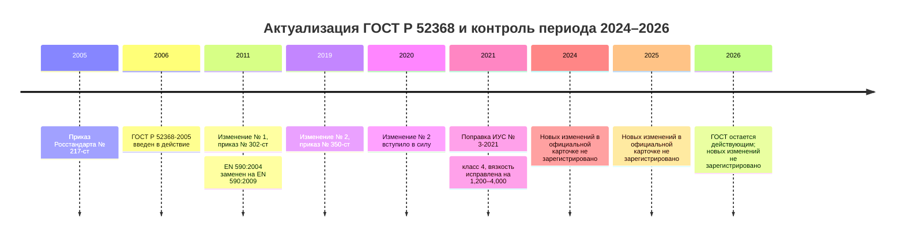

# Актуальные требования к автомобильному дизельному топливу по ГОСТ Р 52368-2005 в России, состояние на 2024–2026 годы

## Краткое резюме

По состоянию на **8 сентября 2026 года ГОСТ Р 52368-2005 «Топливо дизельное ЕВРО. Технические условия» остается действующим**. В официальной карточке Росстандарта после 2021 года новых изменений или поправок не зарегистрировано: последними нормативными вмешательствами являются **Изменение № 1** с введением 1 марта 2012 года, **Изменение № 2** с введением 1 января 2020 года и **поправка, опубликованная в ИУС № 3-2021**. Следовательно, на интервале 2024–2026 численные нормы самого ГОСТ не менялись. citeturn24view0turn24view1turn25view0turn25view1

Действующая структура ГОСТ предусматривает четыре климатических исполнения: **летнее ДТ-Л — сорта A, B, C, D; межсезонное ДТ-Е — сорта E, F; зимнее ДТ-З — классы 0–3; арктическое ДТ-А — класс 4**, а также экологические классы **К3, К4 и К5**. При этом введенное Изменением № 2 примечание прямо говорит, что дизельное топливо, выпускаемое и находящееся в обращении на единой таможенной территории Таможенного союза, должно иметь класс **К5**. То есть К3 и К4 продолжают существовать в нормативной таблице ГОСТ и поэтому приведены ниже, но сам стандарт одновременно указывает на К5 как класс топлива для обращения в рамках ТР ТС 013/2011. citeturn26view0turn26view1

Для общего топлива основные нормы включают: цетановое число не менее **51,0**, цетановый индекс не менее **46,0**, плотность при 15 °C **820,0–845,0 кг/м³**, серу **350/50/10 мг/кг для К3/К4/К5**, ПАУ **11/11/8 % масс. для К3/К4/К5**, закрытый тигель **выше 40 °C для К3 и выше 55 °C для К4/К5**, воду не более **200 мг/кг**, общее загрязнение не более **24 мг/кг**, HFRR не более **460 мкм**, вязкость при 40 °C **2,000–4,500 мм²/с**, FAME не более **7,0 % об.** и фракционные ограничения **<65 % отгона при 250 °C, ≥85 % при 350 °C, T95 ≤360 °C**. citeturn28view1turn28view2turn26view1turn26view2

Для зимних и арктического классов ГОСТ содержит отдельную климатическую таблицу: CFPP от **−20 до −44 °C**, температура помутнения от **−10 до −34 °C**, специальные диапазоны плотности и вязкости, пониженные табличные минимумы цетанового числа и особый фракционный состав: **не более 10 % отгона до 180 °C и не менее 95 % до 340 °C**, то есть функционально **T95 ≤340 °C**. Для класса 4 действующая нижняя граница вязкости — **1,200 мм²/с**, поскольку поправка 2021 года исправила ошибку Изменения № 2, где было напечатано 1,400. citeturn28view3turn31view0turn26view3turn25view0

С **EN 590:2025** российский ГОСТ уже не идентичен актуальной европейской редакции. ГОСТ Р 52368 был переведен Изменением № 1 на нормативную основу **EN 590:2009**, тогда как EN 590:2025 заменила EN 590:2022. Среди подтверждаемых по официальному предпросмотру EN 590:2025 новых отличий — снижение минимальной плотности для летних сортов A/B/C с 820,0 до **815,0 кг/м³** и введение требования по числу частиц **≤10 000 частиц/мл размером ≥4 мкм** в точке сертификации частиц; такого отдельного счетного показателя в ГОСТ Р 52368 нет. citeturn25view1turn33view0

## Статус стандарта и изменения, относящиеся к периоду 2024–2026

Официальный портал Росстандарта помечает ГОСТ Р 52368-2005 как **«Действует»**. Стандарт утвержден приказом № 217-ст от 30 августа 2005 года и введен с 1 июля 2006 года. В карточке перечислены все зарегистрированные изменения и поправки; наиболее поздняя запись — поправка ИУС № 3-2021. Записей за 2024, 2025 или 2026 год на текущей официальной карточке нет. Поэтому оснований говорить о новом численном «изменении 2024–2026» по самому ГОСТ Р 52368 не обнаружено. citeturn24view0

Есть небольшая, но важная библиографическая особенность. Основная карточка Росстандарта по-прежнему отображает полное обозначение как **ГОСТ Р 52368-2005 (ЕН 590:2004)**, однако официальная карточка Изменения № 1 прямо фиксирует замену ссылки **EN 590:2004 → EN 590:2009**, а текст после изменений использует обозначение «ГОСТ Р 52368-2005 (ЕН 590:2009)». Для определения действующего технического содержания корректно учитывать именно изменения к стандарту, а не только неизмененное поле библиографической карточки. citeturn24view0turn25view1turn26view1

Изменение № 1 зарегистрировано приказом Росстандарта № 302-ст от 16 сентября 2011 года и введено 1 марта 2012 года; среди содержательных изменений — переход на EN 590:2009, снижение ПАУ с 11 до 8,0 % на тот момент, увеличение FAME с 5 до 7,0 % и введение отдельной строки температуры вспышки для холодных/арктических классов. citeturn25view1turn26view5

Изменение № 2 зарегистрировано приказом № 350-ст от 2 июля 2019 года и действует с 1 января 2020 года. Оно переработало классификацию, ввело экологические классы К3/К4/К5 непосредственно в действующую структуру, дифференцировало ПАУ и температуру вспышки по экологическим классам, заново изложило строку серы и актуализировало большое количество методов испытаний. citeturn24view1turn26view0turn26view2

Поправка 2021 года зарегистрирована Росстандартом 30 декабря 2020 года и опубликована в ИУС № 3-2021. Для рассматриваемых технических норм особенно существенна правка таблицы 4: у класса 4 ошибочное **1,400–4,000 мм²/с** исправлено на **1,200–4,000 мм²/с**. citeturn25view0turn26view3

**Ограничение первичных источников:** официальный публичный HTML-портал Росстандарта открыто показывает статус стандарта, регистрационные данные и перечень изменений, но полный постатейный текст всех числовых таблиц не раскрывается в его индексируемом HTML. Поэтому ниже официальные карточки Росстандарта используются как первичный источник статуса и редакций, а для дословной проверки табличных чисел дополнительно использована доступная сканированная консолидированная публикация стандарта с Изменениями № 1, № 2 и поправками. Это обозначено в каждой группе строк. citeturn24view0turn29view1turn29view2

## Классификация топлива

После Изменения № 2 пункт 4 задает следующую систему. Летнее топливо обозначается **Л** и подразделяется на сорта A–D; межсезонное — **Е**, сорта E–F; зимнее — **З**, классы 0–3; арктическое — **А**, класс 4. Экологический класс указывается отдельно как К3, К4 или К5. citeturn26view0turn26view1

| Атрибут | Требуемое значение / классификация | Точный пункт / изменение | Первичный источник |
|---|---|---|---|
| Летнее дизельное топливо | ДТ-Л; сорта **A, B, C, D** | п. 4 в редакции Изм. № 2 | Росстандарт: Изм. № 2, зарегистрировано 2019, действует с 2020 г. citeturn24view1; текст редакции citeturn26view0 |
| Межсезонное дизельное топливо | ДТ-Е; сорта **E, F** | п. 4, Изм. № 2 | Росстандарт, Изм. № 2 citeturn24view1; текст citeturn26view0 |
| Зимнее дизельное топливо | ДТ-З; классы **0, 1, 2, 3** | п. 4, Изм. № 2 | Росстандарт, Изм. № 2 citeturn24view1; текст citeturn26view0 |
| Арктическое дизельное топливо | ДТ-А; **класс 4** | п. 4, Изм. № 2 | Росстандарт, Изм. № 2 citeturn24view1; текст citeturn26view0 |
| Экологический класс К3 | К3 предусмотрен структурой ГОСТ | п. 4, Изм. № 2 | Росстандарт, 2019 citeturn24view1; текст citeturn26view0 |
| Экологический класс К4 | К4 предусмотрен структурой ГОСТ | п. 4, Изм. № 2 | Росстандарт, 2019 citeturn24view1; текст citeturn26view0 |
| Экологический класс К5 | К5 предусмотрен структурой ГОСТ; примечание п. 4 требует **К5 для выпуска и нахождения в обращении на единой таможенной территории ТС** | п. 4, примечание, Изм. № 2 | Росстандарт, 2019/2020 citeturn24view1; текст с отсылкой к ТР ТС 013/2011 citeturn26view0 |

Таким образом, **К3 и К4 нельзя просто удалить из таблицы как «неактуальные»**: они по-прежнему являются формально существующими категориями действующего текста ГОСТ и для них установлены собственные пределы серы, ПАУ и температуры вспышки. Одновременно пользователь стандарта должен учитывать примечание п. 4 о К5 для топлива в обращении. citeturn26view0turn26view2

## Полная таблица нормируемых показателей

Ниже сведены показатели таблиц 2–4 с учетом Изменений № 1 и № 2 и поправки 2021 года. В обозначениях **<**, **≤**, **≥** сохранен смысл формулировок стандарта: например, для отгона при 250 °C ГОСТ пишет именно «менее 65», а не «не менее 65». citeturn29view2turn28view2

### Общие физико-химические и эксплуатационные требования

| Атрибут | Требуемое значение / диапазон | Точный пункт / изменение | Первичный источник |
|---|---|---|---|
| Цетановое число | **≥51,0** | п. 5.2, табл. 2, показатель 1; Изм. № 2 актуализировало методы | Росстандарт: действующий ГОСТ citeturn24view0; табл. 2 citeturn28view0turn29view1; Изм. № 2 citeturn26view1 |
| Цетановый индекс | **≥46,0** | п. 5.2, табл. 2, показатель 2 | Росстандарт citeturn24view0; текст табл. 2 citeturn28view0 |
| Плотность при 15 °C | **820,0–845,0 кг/м³** | п. 5.2, табл. 2, показатель 3; Изм. № 2 уточнило запись 820–845 → 820,0–845,0 | Росстандарт, Изм. № 2 citeturn24view1; точная правка citeturn26view1 |
| Полициклические ароматические углеводороды — К3 | **≤11 % масс.** | п. 5.2, табл. 2, показатель 4; Изм. № 2 | Росстандарт, Изм. № 2 citeturn24view1; числовая правка citeturn26view1 |
| Полициклические ароматические углеводороды — К4 | **≤11 % масс.** | п. 5.2, табл. 2, показатель 4; Изм. № 2 | Росстандарт, Изм. № 2 citeturn24view1; текст citeturn26view1 |
| Полициклические ароматические углеводороды — К5 | **≤8 % масс.** | п. 5.2, табл. 2, показатель 4; Изм. № 1 ввело 8,0; Изм. № 2 сохранило 8 для К5 и вернуло 11 для К3/К4 | Росстандарт: Изм. № 1 citeturn25view1, Изм. № 2 citeturn24view1; числовые правки citeturn26view5turn26view1 |
| Сера — К3 | **≤350 мг/кг** | п. 5.2, табл. 2, показатель 5 в редакции Изм. № 2 | Росстандарт, Изм. № 2 citeturn24view1; строка серы citeturn26view2 |
| Сера — К4 | **≤50 мг/кг** | п. 5.2, табл. 2, показатель 5, Изм. № 2 | Росстандарт, Изм. № 2 citeturn24view1; строка серы citeturn26view2 |
| Сера — К5 | **≤10 мг/кг** | п. 5.2, табл. 2, показатель 5, Изм. № 2 | Росстандарт, Изм. № 2 citeturn24view1; строка серы citeturn26view2 |
| Температура вспышки в закрытом тигле — К3 | **выше 40 °C** | п. 5.2, табл. 2, показатель 6; Изм. № 2 заменило 55 на 40 для К3 | Росстандарт, Изм. № 2 citeturn24view1; точная правка citeturn26view1 |
| Температура вспышки в закрытом тигле — К4 | **выше 55 °C** | п. 5.2, табл. 2, показатель 6; Изм. № 2 | Росстандарт, Изм. № 2 citeturn24view1; текст citeturn26view1 |
| Температура вспышки в закрытом тигле — К5 | **выше 55 °C** | п. 5.2, табл. 2, показатель 6; Изм. № 2 | Росстандарт, Изм. № 2 citeturn24view1; текст citeturn26view1 |
| Коксуемость 10%-ного остатка разгонки | **≤0,30 % масс.** | п. 5.2, табл. 2, показатель 7; сноска 5 в редакции Изм. № 2 | Базовая табл. 2 citeturn28view1; актуальная сноска citeturn26view2 |
| Зольность | **≤0,01 % масс.** | п. 5.2, табл. 2, показатель 8 | Табл. 2 citeturn28view1turn29view2; статус ГОСТ citeturn24view0 |
| Вода | **≤200 мг/кг** | п. 5.2, табл. 2, показатель 9 | Табл. 2 citeturn28view1turn29view2 |
| Общее загрязнение | **≤24 мг/кг** | п. 5.2, табл. 2, показатель 10 | Табл. 2 citeturn28view1turn29view2 |
| Коррозия медной пластинки, 3 ч при 50 °C | **класс 1** | п. 5.2, табл. 2, показатель 11 | Табл. 2 citeturn28view1turn29view2 |
| Окислительная стабильность — общее количество осадка | **≤25 г/м³** | п. 5.2, табл. 2, показатель 12 | Табл. 2 citeturn28view2turn29view2 |
| Смазывающая способность, HFRR, скорректированный диаметр пятна износа при 60 °C | **≤460 мкм** | п. 5.2, табл. 2, показатель 13 | Табл. 2 citeturn28view2turn29view2 |
| Кинематическая вязкость при 40 °C | **2,000–4,500 мм²/с** | п. 5.2, табл. 2, показатель 14; Изм. № 2 уточнило количество десятичных знаков | Росстандарт, Изм. № 2 citeturn24view1; правка citeturn26view1 |
| Фракционный состав: отогнано при 250 °C | **<65 % об.** | п. 5.2, табл. 2, показатель 15 | Табл. 2 citeturn28view2turn29view2 |
| Фракционный состав: отогнано при 350 °C | **≥85 % об.** | п. 5.2, табл. 2, показатель 15 | Табл. 2 citeturn28view2turn29view2 |
| Фракционный состав: T95 | **≤360 °C** | п. 5.2, табл. 2, показатель 15 — «95 % перегоняется при температуре не выше 360 °C» | Табл. 2 citeturn28view2turn29view2 |
| FAME / метиловые эфиры жирных кислот | **≤7,0 % об.** | п. 5.2, табл. 2, показатель 16; Изм. № 1: 5 → 7,0 | Росстандарт, Изм. № 1 citeturn25view1; числовая правка citeturn26view5 |
| Качество вводимого FAME | FAME определяется только при его введении; качество должно отвечать ссылочному стандарту на FAME | п. 5.2, табл. 2, сноска 7 | Текст сноски citeturn27view5 |
| T10/T50/T90 для расчета цетанового индекса | **отдельных нормативных максимумов/минимумов нет**; точки 10, 50 и 90 % отгона требуется определить для расчета цетанового индекса | п. 5.2, табл. 2, сноска 2 | Текст сноски citeturn28view2 |
| T50 как самостоятельный показатель качества | **Не нормируется отдельным пределом** | Не предусмотрен отдельной строкой табл. 2–4; упомянут лишь в сноске 2 для расчета индекса | Табл. 2 и сноска citeturn28view2 |
| T90 как самостоятельный показатель качества | **Не нормируется отдельным пределом** | Аналогично T50 | Табл. 2 и сноска citeturn28view2 |
| Конечная температура кипения / EBP | **Отдельного нормативного предела в табл. 2–4 не установлено** | Не найдено как самостоятельный показатель ГОСТ Р 52368 | Фракционные показатели стандарта исчерпываются соответствующими строками табл. 2 и 4 citeturn28view2turn28view3 |

Для коксуемости важно дополнительное условие: предел 0,30 % относится к топливу **до введения присадки, улучшающей воспламенение**, причем применение такой присадки не освобождает изготовителя от соблюдения этого предела до ее введения. citeturn26view2

Для топлива прямой перегонки исходная сноска таблицы 2 допускает на месте производства вместо непосредственного определения цетанового числа применять расчетный метод цетанового индекса. Именно с расчетом индекса связано требование измерять точки отгона T10/T50/T90; само по себе это **не превращает T50 или T90 в отдельные приемочные пределы**. citeturn27view5turn28view2

### Летние и межсезонные сорта

После Изменения № 2 таблица 3 называется таблицей требований к **летнему и межсезонному топливу**. Ее климатический показатель — предельная температура фильтруемости, то есть CFPP. Числовые значения не были изменены Изменением № 2; была обновлена терминология и добавлена ссылка на ГОСТ EN 116. citeturn27view2turn31view0

| Атрибут | Требуемое значение / диапазон | Точный пункт / изменение | Первичный источник |
|---|---|---|---|
| CFPP / предельная температура фильтруемости — сорт A | **≤ +5 °C** | п. 5.3, табл. 3; наименование актуализировано Изм. № 2 | Табл. 3 citeturn27view2; Изм. № 2 citeturn24view1turn31view0 |
| CFPP — сорт B | **≤0 °C** | п. 5.3, табл. 3 | Табл. 3 citeturn27view2 |
| CFPP — сорт C | **≤−5 °C** | п. 5.3, табл. 3 | Табл. 3 citeturn27view2 |
| CFPP — сорт D | **≤−10 °C** | п. 5.3, табл. 3 | Табл. 3 citeturn27view2 |
| CFPP — сорт E | **≤−15 °C** | п. 5.3, табл. 3 | Табл. 3 citeturn27view2 |
| CFPP — сорт F | **≤−20 °C** | п. 5.3, табл. 3 | Табл. 3 citeturn27view2 |
| Температура помутнения для A–F | **Отдельного предела в табл. 3 нет** | п. 5.3, табл. 3 нормирует только CFPP | Табл. 3 citeturn27view2 |

Иными словами, для летнего/межсезонного ряда **cloud point не является отдельным классификационным пределом ГОСТ Р 52368**; он появляется непосредственно в таблице 4 для зимних и арктического классов. citeturn27view2turn28view3

### Зимние и арктический классы

Для зимних классов 0–3 и арктического класса 4 действуют специальные климатические значения таблицы 4. Изменение № 1 добавило туда показатель температуры вспышки, Изменение № 2 актуализировало терминологию, точность записи плотности/вязкости и методы испытаний, а поправка 2021 года исправила вязкость класса 4. citeturn26view5turn31view0turn26view3

| Атрибут | Требуемое значение для классов 0 / 1 / 2 / 3 / 4 | Точный пункт / изменение | Первичный источник |
|---|---|---|---|
| CFPP, °C, не выше | **−20 / −26 / −32 / −38 / −44** | п. 5.3, табл. 4, показатель 1 | Табл. 4 citeturn28view3; актуализация метода Изм. № 2 citeturn31view0 |
| Температура помутнения, °C, не выше | **−10 / −16 / −22 / −28 / −34** | п. 5.3, табл. 4, показатель 2 | Табл. 4 citeturn28view3 |
| Плотность при 15 °C, кг/м³ | **800,0–845,0 / 800,0–845,0 / 800,0–840,0 / 800,0–840,0 / 800,0–840,0** | п. 5.3, табл. 4, показатель 3; запись уточнена Изм. № 2 | Росстандарт, Изм. № 2 citeturn24view1; точная правка citeturn31view0 |
| Кинематическая вязкость при 40 °C, мм²/с | **1,500–4,000 / 1,500–4,000 / 1,500–4,000 / 1,400–4,000 / 1,200–4,000** | п. 5.3, табл. 4, показатель 4; класс 4 — поправка ИУС 3-2021 | Табл. 4 и история изменений citeturn28view3turn31view0; официальная поправка citeturn25view0; исправление citeturn26view3 |
| Цетановое число, не менее | **49,0 / 49,0 / 48,0 / 47,0 / 47,0** | п. 5.3, табл. 4, показатель 5 | Табл. 4 citeturn28view3 |
| Цетановый индекс, не менее | **46,0 / 46,0 / 46,0 / 43,0 / 43,0** | п. 5.3, табл. 4, показатель 6 | Табл. 4 citeturn28view3 |
| Отогнано до 180 °C | **≤10 % об. для всех классов 0–4** | п. 5.3, табл. 4, показатель 7 | Табл. 4 citeturn28view3 |
| Отогнано до 340 °C | **≥95 % об. для всех классов 0–4**; эквивалентно по смыслу T95 ≤340 °C | п. 5.3, табл. 4, показатель 7 | Табл. 4 citeturn28view3 |
| Температура вспышки в закрытом тигле, °C, не ниже | **55 / 55 / 40 / 30 / 30** | п. 5.3, табл. 4, показатель 8, введен Изм. № 1 | Росстандарт, Изм. № 1 citeturn25view1; числовая строка citeturn26view5 |

Здесь имеется важная редакционная особенность ГОСТ. Пункт 5.3 формулирует, что зимнее/арктическое топливо должно соответствовать требованиям таблиц 2 и 4, тогда как таблица 4 повторно задает для некоторых показателей — плотности, вязкости, цетанового числа, индекса, фракционного состава и вспышки — климатически специфические значения. Сам текст, доступный в рассмотренной редакции, **не содержит отдельного правила типа «при конфликте таблица 4 имеет приоритет»**. Поэтому аналитически безопаснее не вычислять искусственно «пересечение» обоих диапазонов, а приводить общие показатели таблицы 2 и специальные значения таблицы 4 отдельно, как это сделано выше. citeturn27view2turn28view3

Особенно показателен этот момент для плотности: общая таблица 2 дает 820–845 кг/м³, а специализированная таблица 4 допускает нижнюю границу 800 кг/м³. Простое арифметическое пересечение сделало бы нижнюю границу 800 бессмысленной; структура стандарта очевидно выделяет таблицу 4 именно как климатическую спецификацию, однако в отчете это не превращено в несуществующую дополнительную норму. citeturn28view0turn28view3

## Дополнительные требования и параметры, которых стандарт не нормирует

Кроме количественных строк таблиц, в действующем тексте есть существенное качественное ограничение на присадки. Изменение № 1 ввело положение, что топливо **не должно содержать металлосодержащие присадки**; Изменение № 2 дополнило соответствующий абзац исключением для антистатических присадок. Поэтому это реальное требование ГОСТ, хотя оно не оформлено как числовая строка таблицы 2. citeturn34view0turn31view0

| Атрибут / вопрос | Действующее положение | Точный пункт | Источник |
|---|---|---|---|
| Металлосодержащие присадки | **Не допускаются**, с учетом позднейшего исключения для антистатических присадок | раздел 7; Изм. № 1 + Изм. № 2 | Изм. № 1 citeturn34view0; Изм. № 2 citeturn31view0 |
| Красители и маркеры | Применение допускается; Изм. № 2 отменило прежнее ограничение по отдельным цветам | раздел 6, Изм. № 2 | Текст изменения citeturn31view0 |
| Температура застывания / pour point | **Не установлена как приемочный показатель в таблицах 2–4** | отсутствует как самостоятельная норма | Состав табл. 2–4 citeturn28view2turn28view3 |
| Cloud point для летнего/межсезонного топлива | **Не установлен** | табл. 3 содержит только CFPP | Табл. 3 citeturn27view2 |
| Cloud point для зимнего/арктического | Нормируется: **−10 / −16 / −22 / −28 / −34 °C** | табл. 4, показатель 2 | Табл. 4 citeturn28view3 |
| T50 | Нормативного предела нет; измеряется для вычисления цетанового индекса | табл. 2, сноска 2 | citeturn28view2 |
| T90 | Нормативного предела нет; измеряется для вычисления цетанового индекса | табл. 2, сноска 2 | citeturn28view2 |
| EBP / конечная точка кипения | **Не нормируется отдельным пределом** | табл. 2 и 4 | citeturn28view2turn28view3 |
| Число частиц, particles/ml | **Отдельной счетной нормы нет**; вместо нее ГОСТ имеет массовое «общее загрязнение» ≤24 мг/кг | табл. 2, показатель 10 | citeturn28view1 |
| Марганец / MMT, числовой предел | Отдельного числового предела в таблицах ГОСТ Р 52368 не найдено; действует более широкое ограничение металлосодержащих присадок | раздел 7 | citeturn34view0turn31view0 |

Изменение № 1 также установило специальный режим контроля для показателей 7, 8 и 12 таблицы 2 — коксуемости, зольности и окислительной стабильности: они гарантируются изготовителем и определяются периодически, один раз в квартал. Это не меняет их численных пределов, но имеет значение для программы производственного контроля. citeturn34view0

Изменение № 2 обновило и требования к хранению: гарантийный срок для топлива без депрессорно-диспергирующей присадки указан как один год со дня изготовления, а для топлива с такой присадкой — шесть месяцев, если иной срок не установлен договором поставки. Это требование эксплуатации/поставки, а не физико-химический показатель партии, поэтому в основной таблице параметров оно не смешано с приемочными пределами. citeturn31view0

## Сопоставление с актуальным EN 590

На 2026 год актуальной европейской редакцией является **EN 590:2025**. Официальный предпросмотр, опубликованный национальным органом стандартизации EVS, указывает, что документ был одобрен CEN 6 июля 2025 года, имеет дату July 2025 и **заменяет EN 590:2022**; национальная реализация EVS-EN 590:2025 действует с 1 сентября 2025 года. citeturn33view0turn32view2

Это принципиально важно: ГОСТ Р 52368 после Изменения № 1 ссылается на **EN 590:2009**, то есть российский стандарт нельзя в 2026 году описывать как идентичный текущему EN 590 только потому, что его название содержит ссылку на EN 590. citeturn25view1turn26view1

| Область | ГОСТ Р 52368, действующая редакция | EN 590:2025 | Аналитическое отличие |
|---|---|---|---|
| Нормативная база | В тексте после Изм. № 1 — **EN 590:2009** | **EN 590:2025**, supersedes EN 590:2022 | Российская редакция отстает на несколько поколений EN 590. citeturn25view1turn33view0 |
| Минимальная плотность летних A/B/C | Общая норма ГОСТ **820,0 кг/м³** | EN 590:2025 снизил минимум A/B/C **с 820,0 до 815,0 кг/м³** | Четкое новое числовое расхождение: −5 кг/м³ по нижней границе европейских A/B/C. citeturn26view1turn33view0 |
| Максимальная плотность общего топлива | ГОСТ **845,0 кг/м³** | Публичный официальный preview, использованный здесь, не воспроизводит полную таблицу 6.6; отдельное новое изменение верхней границы в перечне significant changes не указано | Не следует приписывать EN 590:2025 непроверенную цифру из вторичных таблиц. citeturn33view0 |
| FAME | **≤7,0 % об.** | Область применения EN 590:2025 прямо охватывает топливо с **до 7,0 % об. FAME** | По максимальной доле FAME явного расхождения нет. citeturn26view5turn33view0 |
| Счет частиц | Отдельной нормы counts/ml нет; общее загрязнение **≤24 мг/кг** | Новое EN 590:2025: **≤10 000 частиц/мл для частиц ≥4 мкм** в точке сертификации частиц | Существенное новое требование EN 590:2025, отсутствующее как счетный параметр в ГОСТ Р 52368. citeturn28view1turn33view0 |
| Вязкость — методы | ГОСТ использует набор ГОСТ/ISO методов, актуализированный Изм. № 2 | EN 590:2025 добавил **EN ISO 18335, constant-pressure viscometer**, как альтернативу EN ISO 3104 | Различие главным образом метрологическое, не подтвержденное в preview как изменение российского числового диапазона. citeturn24view1turn33view0 |
| Климатическая система | A–D летние, E–F межсезонные; 0–3 зимние, 4 арктический; CFPP до −44 °C | EN 590:2025 продолжает иметь отдельный раздел 6.7 climate-dependent requirements; его официальное предисловие прямо упоминает летние grades A/B/C при изменении плотности | Полная числовая таблица климатических классов EN 590:2025 отсутствует в открытом официальном preview, поэтому здесь не утверждается без первичного текста, что все CFPP/cloud-point числа остались идентичными российским. citeturn28view3turn33view0 |
| Экологические классы | К3/К4/К5 с серой **350/50/10 мг/кг**; п. 4 одновременно указывает на К5 для обращения | EN 590 не использует российскую классификацию К3/К4/К5 | Российская таблица сохраняет исторические многоуровневые классы; это структурное отличие от современной EN-спецификации. citeturn26view0turn26view2 |
| Металлосодержащие присадки | Общее запрещающее положение, с исключением для антистатических присадок | EN 590:2025 имеет отдельный подпункт **6.2.2 MMT** | Подход к регулированию различается; числовое значение MMT EN 590:2025 не приведено в открытом preview и поэтому здесь не реконструируется из неофициальных источников. citeturn34view0turn33view0 |

Наиболее надежно подтверждаемые новые различия EN 590:2025 — именно **плотность 815 кг/м³ для A/B/C** и **новый предел числа частиц 10 000/мл для ≥4 мкм**. Они прямо перечислены самим EN 590:2025 в разделе «significant technical changes» официального предпросмотра. Там же указаны новый метод вязкости и новый информационный Annex A по particle count. citeturn33view0

По остальным традиционным показателям — цетановому числу, сере, ПАУ, вспышке, воде, загрязнению, HFRR и дистилляции — российские числа в значительной мере отражают структуру поколения EN 590:2009, но полный нормативный текст таблиц EN 590:2025 находится за платным доступом национальных органов стандартизации. Поэтому в этом отчете **не подменяется первичный EN 590:2025 вторичными коммерческими таблицами**, а непроверенные по официальному 2025-тексту числа намеренно не объявляются «актуальными EN 590». Сам официальный preview подтверждает, что полный документ содержит общие требования в п. 6.6 и климатические требования в п. 6.7, но не показывает соответствующие таблицы полностью. citeturn32view2turn33view0

## Итоговая оценка для применения в 2024–2026 годах

Для спецификации дизельного топлива **«по ГОСТ Р 52368» на 2024–2026 годы следует использовать редакцию после Изменения № 2 и поправки ИУС № 3-2021**. Официальная карточка Росстандарта не содержит более новых поправок; стандарт продолжает иметь статус действующего. citeturn24view0turn24view1turn25view0

Для обычного К5-топлива базовый аналитический профиль по ГОСТ можно кратко выразить как: **S ≤10 мг/кг; CN ≥51,0; CI ≥46,0; PAH ≤8 % масс.; ρ15 = 820,0–845,0 кг/м³; ν40 = 2,000–4,500 мм²/с; flash point >55 °C; H₂O ≤200 мг/кг; total contamination ≤24 мг/кг; ash ≤0,01 %; carbon residue ≤0,30 %; oxidation sediment ≤25 г/м³; HFRR ≤460 мкм; FAME ≤7,0 % об.; distillation <65 % at 250 °C, ≥85 % at 350 °C, T95 ≤360 °C.** citeturn26view1turn26view2turn28view1turn28view2

Для зимнего/арктического топлива к этому необходимо читать специализированную таблицу 4: **CFPP −20/−26/−32/−38/−44 °C, cloud point −10/−16/−22/−28/−34 °C, T95 фактически ≤340 °C**, с отдельными диапазонами плотности, вязкости и цетановых характеристик; класс 4 после поправки 2021 года имеет вязкость **1,200–4,000 мм²/с**. citeturn28view3turn26view3

Ни **T50**, ни **T90**, ни **EBP/final boiling point**, ни **pour point** не имеют самостоятельного приемочного предела в рассмотренных таблицах ГОСТ Р 52368. T10/T50/T90 используются как исходные точки для расчета цетанового индекса; нормативными фракционными ограничениями являются проценты отгона при заданных температурах и T95. Для летних и межсезонных сортов нормируется CFPP, но не cloud point; cloud point появляется только для классов 0–4 таблицы 4. citeturn28view2turn27view2turn28view3

Наконец, обозначение «по ГОСТ Р 52368 (EN 590)» в 2026 году **не означает автоматического соответствия EN 590:2025**. Европейский стандарт уже пересмотрен: в частности, у A/B/C минимум плотности снижен до 815 кг/м³ и введен новый счетный критерий частиц. Для контрактов, где требуется одновременно **ГОСТ Р 52368 и актуальный EN 590:2025**, соответствие следует проверять как двум самостоятельным наборам требований, а не считать их взаимозаменяемыми. citeturn25view1turn33view0