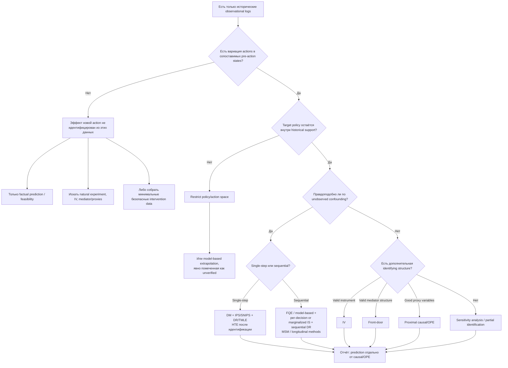

# Оценка качества рекомендательных и управляющих политик для промышленного процесса только по историческим наблюдениям

## Исполнительное резюме

Главный вывод литературы состоит в том, что при отсутствии симулятора и онлайн-эксперимента качество новой управляющей политики нельзя свести к обычной проверке точности модели на исторических данных. **Хорошее предсказание того, что исторически происходило после действий старого контроллера, не доказывает правильность предсказания того, что произошло бы после другого действия.** Это различие между predictive modeling и causal/counterfactual inference является фундаментальным: предиктивная модель оценивает ассоциации в наблюдаемом распределении, тогда как оценка политики требует ответить на контрфактический вопрос о результате при изменении механизма выбора действия. citeturn22view0turn22view3turn17academia46

В постановке промышленного управления нужно сначала различить три существенно разные ситуации.

| Ситуация в логах | Что принципиально возможно |
|---|---|
| Исторический контроллер/операторы выбирали **разные действия в сопоставимых состояниях**, хотя без рандомизации | OPE и причинный анализ могут быть применимы, но только при предположениях об отсутствии неизмеренного смешения, overlap/positivity и корректной временной структуре. |
| Некоторые рекомендуемые новой политикой действия **никогда или почти никогда не выполнялись в соответствующих состояниях** | Непараметрическая OPE теряет идентифицируемость; IPS/IS становятся невозможными либо нестабильными, а model-based оценки превращаются в экстраполяцию. |
| В отношении интересующей интервенции в данных фактически **нет вариации вообще** — например, новый режим оборудования никогда не включался | Эффект такой интервенции из одних этих логов не идентифицируется без дополнительных структурных предположений, естественного эксперимента, инструмента, медиатора или новых данных. |

Требование overlap является не технической мелочью. IPS предполагает, что историческая logging policy имела ненулевую вероятность тех действий, которые может выбрать оцениваемая политика; для support-deficient данных известны катастрофические режимы отказа, а стандартными мерами являются ограничение множества действий, ограничение target policy и явно обозначенная model-based экстраполяция. citeturn20view0turn21view0

Для промышленного процесса это особенно критично. Если существующий PID/MPC/PLC-контроллер почти детерминированно выбирает \(a_t=f(s_t)\), то в одном и том же состоянии практически нет альтернативных действий. В этом случае наличие миллионов строк historian-а не создаёт causal overlap: данных может быть много глобально, но почти не быть информации о сравнении альтернативных действий **условно на состояние процесса**. Именно эта проблема распределительного сдвига между историческими и новыми state–action pairs является одной из центральных проблем offline RL. citeturn19view0turn20view0

Наиболее защищённая практика при хорошем overlap и достаточно правдоподобном no-unobserved-confounding — не выбирать единственный OPE estimator, а **триангулировать** результат: direct/model-based или FQE + IPS/importance sampling или marginalized density-ratio estimator + doubly robust estimator. DR полезен именно потому, что комбинирует outcome model и propensity/logging-policy model; в классическом варианте он сохраняет корректность, если корректна хотя бы одна из этих двух nuisance-моделей. Однако термин *doubly robust* **не означает** устойчивость к неизмеренным confounders и не исправляет отсутствие overlap. citeturn19view2turn19view1turn23view2

Для последовательного промышленного управления обычный single-step propensity analysis часто недостаточен. Действие меняет последующее состояние, которое влияет на следующее действие и одновременно на будущий outcome. Это классическая структура time-varying treatment/confounding; здесь применимы sequential importance sampling, sequential doubly robust OPE, fitted-Q evaluation, marginal structural models, longitudinal g-formula и longitudinal TMLE. citeturn23view2turn17search0turn24view3

Если неизмеренное смешение — например, оператор видел вибрацию, звук, качество сырья или диагностический экран, не попавший в historian, — правдоподобно, стандартные IPS/DR/TMLE/back-door методы могут систематически ошибаться. В последовательных задачах даже небольшое скрытое смешение на каждом шаге способно сильно искажать OPE. Тогда литература рекомендует sensitivity analysis/partial identification, а при наличии специальной структуры — instrumental variables, front-door identification или proximal causal/OPE методы с proxy-переменными. citeturn23view2turn23view3turn17search9

**Рекомендуемый стандарт отчётности — два независимых блока качества.**

**Блок A — подтверждаемая предиктивная валидность на наблюдаемом мире.** Например: MAE/RMSE/R²/NLL, multi-step forecasting error, calibration, residual diagnostics, temporal/plant holdout.

**Блок B — контрфактическая/политическая оценка, условная на предположениях.** Например: \(\hat V(\pi)\), \(\Delta\hat V=\hat V(\pi)-\hat V(\mu)\), CI/lower confidence bound, overlap, effective sample size, распределение importance weights, доля target-policy decisions вне support, согласие нескольких OPE estimators и sensitivity interval к hidden confounding.

Эти два блока нельзя объединять в один «model accuracy score»: даже почти идеальная factual prediction может сосуществовать с полностью неидентифицируемым action effect. Это напрямую следует из различия prediction и causation и из фундаментальной невозможности наблюдать одновременно оба potential outcomes для одной и той же единицы. citeturn22view0turn21view0turn17academia46

## Что именно идентифицируется из пассивных промышленных логов

Пусть в момент \(t\) имеется наблюдаемая история

\[
H_t=(S_1,A_1,S_2,A_2,\ldots,S_t),
\]

историческая policy \(\mu(a\mid H_t)\) выбирает действие \(A_t\), а новая policy \(\pi(a\mid H_t)\) предлагает альтернативное действие. Цель OPE — оценить, например,

\[
V(\pi)
=
\mathbb E_{\pi}
\left[
\sum_{t=1}^{T}\gamma^{t-1}R_t
\right],
\]

хотя реальные trajectories были получены при \(\mu\), а не при \(\pi\). Именно поэтому OPE по определению является контрфактической задачей. citeturn23view2turn25view0

Для single-step решения потенциальные результаты можно записать как \(Y(a)\). Наблюдается только

\[
Y=Y(A),
\]

а \(Y(a')\) для невыполненного \(a'\) остаётся counterfactual. Для бинарной интервенции индивидуальный эффект

\[
\tau_i=Y_i(1)-Y_i(0)
\]

никогда напрямую не наблюдается: для одного объекта доступен максимум один из двух potential outcomes. Поэтому даже в идеальном observational study обычно оценивают ATE/CATE, а не проверяемый истинный индивидуальный ITE. citeturn21view0

Для стандартной идентификации по наблюдательным данным нужны как минимум следующие содержательные предположения.

**Consistency/SUTVA.** Записанное действие должно однозначно соответствовать рассматриваемой интервенции, а outcome данного episode/unit не должен зависеть от неучтённого вмешательства на другой unit, если interference не смоделирован. В промышленности нарушение возможно, например, если изменение одного аппарата влияет через общую utility-систему или upstream/downstream связи на другой аппарат. citeturn21view0

**Exchangeability / unconfoundedness.** В single-step варианте:

\[
Y(a)\perp A\mid X.
\]

То есть после conditioning на записанные pre-action variables выбор действия не должен содержать дополнительной информации о потенциальном результате. В sequential варианте требуется соответствующая sequential ignorability относительно всей доступной до решения истории. citeturn21view0turn23view2

**Positivity / overlap.**

\[
P(A=a\mid X=x)>0
\]

для всех \((x,a)\), используемых target policy. В OPE эквивалентное требование означает, что если \(\pi(a\mid h)>0\), то \(\mu(a\mid h)>0\). Без этого исторические данные ничего непосредственно не сообщают о соответствующем counterfactual. citeturn20view0turn23view2

**Корректная временная ориентация.** В confounder set должны входить переменные, известные **до** действия. Conditioning на переменную, уже изменённую этим действием, может превращать mediator/post-treatment variable в ошибочный adjustment variable. Для повторяющихся решений обычная регрессия становится особенно опасной, поскольку сегодняшний process state может быть одновременно следствием вчерашнего control action и причиной сегодняшнего действия; именно для таких структур создавались longitudinal g-methods и marginal structural models. citeturn17search0turn23view2

Отсюда следует важное для historian-данных различие. Наблюдаемая естественная вариативность — изменения нагрузки, сырья, смен, режимов MPC, ручных overrides, setpoints — может создавать полезный overlap. Но **вариабельность сама по себе не делает действие экзогенным**: оператор нередко меняет управление именно потому, что ожидает ухудшение процесса. Это causal analogue «confounding by indication». Если причины override полностью записаны до действия, back-door adjustment может помочь; если часть причины известна оператору, но отсутствует в логе, остаётся hidden confounding. Общая OPE-теория прямо показывает, что отсутствие таких скрытых факторов является ключевым условием идентификации. citeturn23view2

Таким образом, при буквальном условии «никаких интервенций в данных нет» наиболее важный вопрос звучит не «какой estimator выбрать?», а **«есть ли вообще наблюдаемая вариация в control action, перекрывающая действия новой policy?»**. Если ответ отрицательный, выбор между IPS, DR, TMLE и causal forest не решает проблему: все они нуждаются либо в variation/overlap, либо в дополнительной идентифицирующей структуре. citeturn20view0turn21view0

## Основные семейства методологий

**Inverse Propensity Scoring / Inverse Probability Weighting / Importance Sampling.** Идея — придать больший вес тем историческим наблюдениям, которые target policy выбирала бы чаще, чем behavior policy. В contextual-bandit случае типичный вес:

\[
w_i
=
\frac{\pi(A_i\mid X_i)}
     {\mu(A_i\mid X_i)},
\qquad
\hat V_{\mathrm{IPS}}
=
\frac1n\sum_i w_iR_i.
\]

В sequential OPE используются произведения likelihood ratios по trajectory:

\[
\rho_{1:T}=
\prod_{t=1}^{T}
\frac{\pi(A_t\mid H_t)}
     {\mu(A_t\mid H_t)}.
\]

При sequential ignorability и overlap соответствующая importance-sampling identity идентифицирует policy value. citeturn19view2turn23view2

Сильная сторона IPS/IS — отсутствие необходимости правильно специфицировать reward/dynamics model. Слабая — дисперсия: если behavior policy редко выбирает action, которому target policy даёт большую вероятность, знаменатель мал, а weights огромны. В длинных horizons произведение весов дополнительно обостряет проблему. Self-normalized IS/IPW стабилизирует оценку за счёт нормализации весов, обычно меняя чистую unbiasedness на меньшую конечновыборочную variance. Marginalized importance sampling и density-ratio методы вместо полного trajectory ratio оценивают более маргинальные occupancy ratios и являются важным современным направлением OPE. citeturn19view2turn15academia2turn25view0

Для промышленного применения IPS особенно полезен, когда logging policy известна или может быть достоверно восстановлена, например если в журнале сохранены параметры stochastic controller. Если policy почти детерминирована, propensity около нуля для альтернативных actions делает такой анализ практически бесполезным. Для continuous actuator \(A\) требуется отношение conditional **densities**, а не вероятностей отдельных значений; при высокой размерности action space задача становится ещё сложнее. Ключевые diagnostics: overlap plots, min/max propensity, tail weights, effective sample size, доля clipped/trimmed observations и доля target-policy mass вне empirical support. citeturn20view0turn24view2

**Direct Method, outcome regression, g-computation и model-based OPE.** Здесь обучается модель

\[
\hat m(x,a)\approx E[Y\mid X=x,A=a]
\]

или динамическая модель

\[
\hat P(s_{t+1},r_t\mid s_t,a_t),
\]

после чего policy оценивается путём замены фактического action на target action либо rollout-а learned dynamics. В reinforcement learning близкий model-free вариант — Fitted Q Evaluation: для фиксированной target policy итеративно оценивается её \(Q^\pi(s,a)\) через Bellman regression. Model-based и value-function approaches избегают экстремальных IS weights и поэтому часто имеют существенно меньшую variance. citeturn19view1turn25view0

Цена — model bias. Особенно опасна ситуация, когда модель имеет превосходный one-step RMSE на исторических state–action pairs, но новая policy систематически задаёт actions за пределами training support. Тогда rollout использует модель там, где её causal response surface не проверялась. Offline-RL literature рассматривает такой distribution shift как фундаментальную проблему, а не обычный вопрос predictive generalization. citeturn19view0turn20view0

Именно поэтому построенный только по observational logs «digital twin» не следует автоматически считать независимым симулятором для валидации policy: если его response to actions не проверен в relevant intervention regions, он представляет собой ещё одну counterfactual model, разделяющую те же идентификационные ограничения. Это вывод из общей теории offline RL и causal inference, а не критика цифровых двойников как таковых. citeturn19view0turn22view3

**Doubly Robust / AIPW.** DR объединяет direct outcome model и propensity weighting. В contextual setting:

\[
\hat V_{\rm DR}
=
\frac1n\sum_i
\left[
\sum_a\pi(a\mid X_i)\hat m(X_i,a)
+
\frac{\pi(A_i\mid X_i)}
{\hat\mu(A_i\mid X_i)}
\left(R_i-\hat m(X_i,A_i)\right)
\right].
\]

Первый член — model-based prediction; второй корректирует его observed residuals с помощью importance weights. В классической постановке DR estimator остаётся consistent/unbiased при корректности либо propensity model, либо outcome model, что делает его одним из базовых решений для observational policy evaluation. citeturn19view2

Для sequential RL Jiang–Li и последующие работы развили sequential doubly robust estimators; Thomas–Brunskill предложили дополнительно смешивать model-based и importance-sampling компоненты для снижения MSE. citeturn14academia10turn19view1

Но здесь нужна терминологическая осторожность: **double robustness ≠ robustness to unobserved confounding**. Если и action assignment, и outcome зависят от незаписанного \(U\), neither propensity correction nor outcome regression устраняет эту зависимость. Namkoong et al. прямо показывают, что standard OPE estimators оказываются biased при нарушении sequential ignorability. DR также не спасает positivity violation. citeturn23view2turn20view0

**TMLE и Double/Debiased Machine Learning.** Targeted Maximum Likelihood Estimation начинает с гибких nuisance-models — outcome regression и treatment mechanism — и затем целенаправленно обновляет их по efficient influence curve относительно конкретного causal estimand. Исходная работа van der Laan & Rubin показывает связь TMLE с locally efficient и doubly robust estimation. citeturn24view3

Double/Debiased ML использует Neyman-orthogonal estimating equations и cross-fitting, чтобы уменьшить regularization/overfitting bias при использовании ML для nuisance components. Важный тезис исходной работы сформулирован особенно релевантно для данного вопроса: высокая predictive performance современного ML сама по себе не даёт хорошего estimator-а causal parameters; для этого нужна специальная orthogonalization/debiasing construction. citeturn17academia46turn17search10

В industrial data TMLE/DML привлекательны при высокоразмерных covariates — сотнях sensors, режимных признаков и lag-features — если treatment assignment всё же имеет достаточный overlap. Их преимущество относится к robustness против ошибок nuisance estimation и regularization, **не** против произвольного hidden confounding. Diagnostics должны включать cross-fitting по независимым episodes/time blocks, positivity, distribution of clever covariate/weights, sensitivity к nuisance learner и causal assumptions. citeturn24view3turn17academia46

**Back-door adjustment и propensity-score causal inference.** В structural causal model/DAG подходе задача состоит в выборе набора \(X\), блокирующего все back-door paths от action \(A\) к outcome \(Y\). После этого effect можно оценивать regression/g-computation, matching, stratification, IPW, AIPW, TMLE или DML. Классическая causal-diagram literature Pearl формализовала back-door и front-door criteria именно как условия идентификации causal effect из observational distributions. citeturn23view1

Промышленная ценность DAG здесь велика: инженер может явно отметить upstream disturbances, feed quality, load, setpoint, production grade, equipment health, operator mode и прочие общие причины \(A\) и \(Y\). Это существенно лучше, чем механически добавлять все доступные теги в regression, поскольку collider/post-treatment adjustment способен создавать bias. Но валидность back-door identification остаётся содержательным предположением о полноте измеренных confounders. citeturn21view0turn22view3

**Longitudinal g-formula и marginal structural models.** Когда решения повторяются, \(L_t\) может влиять на \(A_t\), но одновременно быть следствием \(A_{t-1}\). Обычная adjustment regression в такой структуре способна либо недоучесть confounding, либо conditioning-ом блокировать часть causal pathway. Marginal structural models с inverse-probability weights были введены именно для time-dependent treatment/confounding; OPE и dynamic-treatment-regime literature тесно связаны математически. citeturn17search0turn23view2

Для process control это один из наиболее содержательно подходящих causal frameworks, когда цель звучит как «что произойдёт с качеством партии и energy use, если в течение часа следовать другой последовательности setpoints?», а не как single-step recommendation. Требуются последовательные consistency, positivity и exchangeability assumptions. Типичные outputs — mean cumulative outcome, survival/time-to-failure-type endpoints, cumulative costs, ATE между dynamic regimes и CI. citeturn23view2turn3search3

**Uplift modeling и heterogeneous treatment effects.** Uplift/CATE методы отвечают на вопрос не только «работает ли действие в среднем?», но и «для каких состояний процесса оно полезнее?»:

\[
\tau(x)
=
E[Y(1)-Y(0)\mid X=x].
\]

Обзор Zhang, Li & Liu объединяет uplift modeling и HTE в potential-outcome framework и подчёркивает, что observational интерпретация требует overlap, SUTVA и unconfoundedness. citeturn21view0

Meta-learners превращают causal estimation в несколько supervised subproblems. **S-learner** обучает одну модель \(Y=f(X,A)\); **T-learner** — отдельные outcome models для treatment и control; **X-learner** дополнительно строит imputed treatment effects и особенно интересен при несбалансированных группах. Эти конструкции популярны именно потому, что позволяют использовать практически любые базовые regressors. citeturn21view1

**Causal forests / generalized random forests** непосредственно ищут гетерогенность эффектов и при соответствующих assumptions позволяют получать asymptotic inference для CATE. Doubly robust CATE estimators, включая работы Kennedy, дополнительно используют orthogonalized pseudo-outcomes. citeturn21view2turn21view3

Критический момент оценки HTE: истинный ITE для реального объекта неизвестен, поэтому обычный RMSE между \(\hat\tau_i\) и «истинным \(\tau_i\)» на observational plant data вычислить невозможно. PEHE/ITE-RMSE уместны на synthetic/semi-synthetic benchmarks, где counterfactual ground truth искусственно известен. На реальных данных разумнее использовать out-of-sample policy value, treatment-effect calibration по группам, uplift/Qini/AUUC-type curves при валидном treatment/control design и robustness/sensitivity analysis. citeturn21view0

Если в исторических логах вообще не было альтернативного treatment/action, uplift modeling не создаёт causal signal из ничего: S/T/X-learner просто вынужден экстраполировать один из потенциальных outcomes. Это следует непосредственно из overlap requirement. citeturn21view0

**Instrumental variables.** IV применимы, когда существует переменная \(Z\), которая причинно меняет вероятность/интенсивность action \(A\), но не воздействует на \(Y\) другим путём и не разделяет с \(Y\) соответствующее hidden confounding. Классическая formulation Angrist–Imbens–Rubin связывает IV с potential outcomes и, для распространённой бинарной постановки с monotonicity, приводит к локальному causal effect для compliers. citeturn17search9turn17search26

В промышленности потенциальными — но не автоматически валидными — instruments могут быть внешние dispatch instructions, schedule constraints, смена версии controller по административному правилу, exogenous feed allocation или hardware threshold, который изменяет action choice. Самая трудная часть — защитить exclusion restriction. Статистически сильный first stage не доказывает exclusion. Поэтому рекомендуются first-stage strength/partial-\(R^2\), weak-instrument-robust inference, falsification tests на pre-treatment outcomes и инженерное обоснование causal graph. IV — один из немногих стандартных способов получать идентификацию **при наличии unobserved confounding**, но лишь благодаря дополнительным сильным assumptions. citeturn17search9

**Front-door adjustment.** Front-door identification может, в специальных DAG-структурах, идентифицировать effect даже при скрытом confounder между action и outcome. Нужен mediator \(M\), через который проходят соответствующие causal paths \(A\rightarrow Y\); должны быть удовлетворены условия об отсутствии подходящих unblocked back-door paths для \(A\rightarrow M\) и корректной adjustment-структуре для \(M\rightarrow Y\). Метод основан на causal graph structure, а не на predictive fit. citeturn23view1

Промышленный пример возможен теоретически: command \(A\) влияет на фактически достигнутый physical intermediate \(M\), а тот — на product quality \(Y\), причём hidden operator information confounds \(A\) и \(Y\), но не нарушает необходимые mediator assumptions. На практике front-door conditions значительно сильнее, чем кажется, поэтому этот путь следует рассматривать как специальный идентификационный дизайн, а не универсальную замену back-door adjustment. citeturn23view1

**Synthetic control и difference-in-differences.** Они становятся релевантными, когда policy change всё-таки произошёл хотя бы на одном plant/unit/time period, а другие линии/установки могут быть controls. Synthetic control строит weighted combination untreated donor units, хорошо воспроизводящую pre-intervention trajectory treated unit, и сравнивает post-intervention trajectories. Классическая работа Abadie, Diamond & Hainmueller рассматривает именно one/few treated units, donor units и pre-treatment outcomes. citeturn17search1turn17academia47

Это особенно полезно не для millisecond control actions, а для plant-level изменений: переход на новый MPC, новую recipe logic, optimization layer, maintenance policy или operator recommendation system. Основные diagnostics — pre-treatment fit/RMSPE, placebo interventions по контрольным units, placebo dates, robustness к donor pool и pre-period. Если **ни одна** установка не получила intervention, synthetic control causal effect оценить не может. citeturn17search1turn17academia47

**Sensitivity analysis, partial identification и proximal methods.** Когда no-unobserved-confounding неправдоподобно, более честным результатом часто является не point estimate, а диапазон policy values под явно заданной силой hidden confounding. Namkoong et al. разрабатывают именно worst-case bounds для sequential OPE и показывают, насколько чувствительным может быть long-horizon result. citeturn23view2

Proximal causal inference / proximal RL идёт дальше: при наличии специальных proxy variables для скрытого состояния можно идентифицировать OPE через bridge functions даже в частично наблюдаемой системе. Цена — дополнительные completeness/proxy assumptions, которые требуют сильного domain justification. Для промышленного historian это потенциально интересно, когда hidden state не записан напрямую, но существуют связанные proxy sensors или diagnostic signals. citeturn23view3

Это важная общая иерархия: **standard OPE** пытается получить point identification при ignorability; **IV/front-door/proximal** заменяют ignorability другой идентифицирующей структурой; **sensitivity/partial identification** признают, что point identification недостижима, и отвечают более слабым, но защищаемым интервалом. citeturn23view2turn23view3

## Сравнение методов для промышленного управления

| Метод | Предположения о данных | Bias / variance | Устойчивость к неизмеренному confounding | Типичные применения в process control | Рекомендуемые diagnostics |
|---|---|---|---|---|---|
| **Direct Method / outcome regression / g-computation** | Consistency, unconfoundedness для causal interpretation; target actions должны быть достаточно представлены либо придётся экстраполировать | Обычно низкая variance, потенциально высокий model/extrapolation bias | **Нет** | Эффект изменения setpoint/action; single-step recommendations | Temporal/site holdout; outcome residuals; action-conditional calibration; support map; отдельно качество в near-support и extrapolation regions. citeturn19view2turn19view0 |
| **Model-based OPE / learned dynamics** | Markov/state sufficiency или адекватная history representation; корректная action-response dynamics | Низкая Monte-Carlo variance, но compounding model bias по horizon | **Нет** | Rollout новой sequence policy, energy/quality trajectories | One- и multi-step error по horizon; state/action coverage; rollout drift; uncertainty growth; сравнение с IS/DR. citeturn19view0turn19view1 |
| **Fitted Q Evaluation** | Coverage target-policy state-actions; достаточная representation; Bellman approximation | Обычно лучше variance, чем trajectory IS; approximation/distribution-shift bias | **Нет** | Long-horizon policy ranking без explicit dynamics | Bellman residual; temporal holdout; policy-support distance; sensitivity к function class/hyperparameters. citeturn25view0turn14academia11 |
| **IPS/IPW** | Известная/оценимая behavior propensity; ignorability; строгий overlap | Низкий asymptotic bias при корректной propensity, иногда огромная variance | **Нет** | Дискретные operator recommendations, mode selection | Propensity histograms; max/quantiles of weights; ESS; clipping sensitivity; target-policy support. citeturn19view2turn20view0 |
| **Trajectory / per-decision IS** | Sequential ignorability и overlap на каждом шаге | Trajectory IS часто чрезвычайно высоковариантен с horizon; per-decision лучше | **Нет** | Последовательные recipes/control actions при stochastic logger | ESS по horizon; cumulative log-weight distribution; weight domination; episode-level bootstrap. citeturn23view2turn25view0 |
| **Self-normalized IS/IPW** | То же, что IS/IPW | Обычно меньшая variance за счёт некоторого finite-sample bias | **Нет** | Когда ordinary IS нестабилен, но overlap всё ещё приемлем | ESS, weight concentration, difference SNIS vs IS, bootstrap CI. citeturn24view2 |
| **Marginalized IS / density-ratio OPE** | Sequential coverage; корректная estimation occupancy/density ratios | Может резко уменьшить variance относительно full trajectory ratios; nuisance-estimation bias | **Нет** | Длинные trajectories с достаточным state-action coverage | Occupancy ratio tails; moment/balance checks; estimator sensitivity. citeturn15academia2turn25view0 |
| **Doubly Robust / AIPW / sequential DR** | Overlap + ignorability; хотя бы одна из propensity/outcome nuisance models должна быть корректна для классической DR guarantee | Компромисс между DM bias и IPS variance; обычно выгодная bias–variance позиция | **Нет** | Хороший default для observational recommendations при хорошем overlap | Все propensity diagnostics + outcome calibration; cross-fitting; DR/DM/IPS disagreement. citeturn19view2turn19view1 |
| **TMLE / longitudinal TMLE** | Идентифицируемый causal parameter, positivity, exchangeability; nuisance models | Targeted low-bias/efficient inference при условиях; может страдать от near-positivity | **Нет** | ATE/policy contrasts; dynamic regimes, high-dimensional sensor covariates | Positivity; extreme clever covariates; nuisance CV; influence-curve SE; sensitivity analysis. citeturn24view3 |
| **DML / orthogonal estimation** | Unconfoundedness/valid moment condition; overlap; sample splitting | Уменьшает first-order nuisance/regularization bias; требует достаточных rates | **Нет** | High-dimensional sensor sets, flexible propensity/outcome ML | Cross-fitting by batch/time; balance/overlap; nuisance stability; CI. citeturn17academia46 |
| **Back-door + matching/weighting/regression** | Правильный causal DAG; все relevant back-door confounders измерены | Зависит от estimator; extrapolation и misspecification остаются | **Нет** | Operator overrides, recipe/mode changes с хорошо записанными causes | DAG review; balance; overlap; negative controls; alternate adjustment sets. citeturn23view1turn21view0 |
| **MSM / longitudinal g-formula** | Sequential exchangeability/positivity/consistency | IPTW-варианты могут быть высоковариантными; g-formula — model-sensitive | **Нет** | Time-varying setpoint/action sequences и delayed outcomes | Stabilized weights; longitudinal positivity; truncation sensitivity; temporal causal ordering. citeturn17search0turn23view2 |
| **S/T/X-learners, uplift models** | Treatment/control variation, overlap, unconfoundedness для observational data | S: shared-model bias; T: variance при малых группах; X часто выгоден при imbalance | **Нет** | Определение process states, где intervention имеет наибольший incremental effect | Overlap by subgroup; CATE calibration; uplift/Qini-type curves; out-of-sample policy value; не использовать factual outcome RMSE как CATE validation. citeturn21view0turn21view1 |
| **Causal forests / GRF / DR-CATE** | Overlap + unconfoundedness; достаточная локальная sample size | Гибкая HTE estimation; variance растёт в редких subgroups | **Нет** | Поиск operating regions с разным response to action | Leaf/local overlap; honest/sample-split estimation; grouped calibration; effect CI; policy value. citeturn21view2turn21view3 |
| **Instrumental variables** | Relevance, independence/exogeneity, exclusion; дополнительные условия для конкретного estimand | Weak instruments дают большую variance/bias; estimand часто локален | **Да, к определённому hidden confounding**, если IV действительно валиден | Exogenous dispatch/schedule/controller-assignment variations | First-stage strength; weak-IV inference; pre-outcome falsification; engineering defense of exclusion. citeturn17search9 |
| **Front-door adjustment** | Специальная mediator DAG structure и соответствующие front-door conditions | Может идентифицировать effect без standard ignorability; сильно зависит от структуры | **Да, для допустимой hidden-confounding структуры** | Action → measurable physical mediator → quality/outcome | DAG audit; mediator coverage; tests на timing; alternative pathways; sensitivity. citeturn23view1 |
| **Synthetic control / DiD** | Реальная intervention хотя бы на одном unit/time; controls; для SCM — хороший pre-period donor fit; для DiD — parallel-trends-type design | Часто низкая model complexity, но design bias при плохих controls/trends | **Частично**, не против arbitrary time-varying confounding | Ввод нового controller/MPC/optimizer на одной линии/площадке | Pre-fit; placebo units/dates; donor sensitivity; pre-trends. citeturn17search1turn17academia47 |
| **Sensitivity bounds / partial identification** | Задаётся допустимая сила hidden confounding вместо ignorability | Намеренно даёт более широкие интервалы вместо сомнительного point estimate | **Да, в пределах заданной sensitivity model** | Критические operator decisions с неполными логами | Value bounds при сетке \(\Gamma\); tipping point, где policy ranking меняется. citeturn23view2 |
| **Proximal causal/OPE** | Валидные treatment/outcome proxies, bridge/completeness conditions | Сложнее estimation; потенциально высокая variance/ill-conditioning | **Да**, при выполнении proxy assumptions | Latent process/operator state с качественными proxy signals | Proxy relevance; bridge stability; sensitivity к proxy set; partial-observability diagnostics. citeturn23view3 |

Практически ни один столбец таблицы не следует интерпретировать как «лучший алгоритм». Центральная развилка — **identification first, estimator second**. Если positivity или causal assumptions провалены, улучшение нейросети, boosting-модели или propensity estimator не исправляет фундаментальную нехватку информации. citeturn20view0turn23view2

## Как отдельно отчитываться о predictive accuracy и неизвестном эффекте действия

Литература даёт очень чёткое основание не смешивать эти понятия. Shmueli различает prediction — предсказание новых observable \(Y\) по \(X\) — и causal explanation; Bottou et al. отдельно формулируют задачу предсказания последствий **изменения** работающей системы как counterfactual reasoning; Chernozhukov et al. подчёркивают, что ML, оптимизированный для predictive performance, не превращается автоматически в хороший estimator causal parameters. citeturn22view0turn22view3turn17academia46

Для process-control проекта это полезно формализовать следующим образом.

**Уровень «Factual prediction — эмпирически проверено».** Модель проверяется только на реально наблюдавшихся transitions:

\[
(s_t,a_t)\rightarrow(s_{t+1},r_t)
\]

при исторической policy. Здесь вполне законны обычные supervised metrics:

\[
\mathrm{MAE},\quad
\mathrm{RMSE},\quad
R^2,\quad
\mathrm{NLL},
\]

для событий — Brier score/AUC/calibration, для динамики — error versus forecast horizon. В промышленном time series желательно делать chronological/episode/batch holdout, а не случайный split строк, чтобы leakage из сильной временной автокорреляции не создавала иллюзию качества. Последняя рекомендация является практическим следствием sequential nature process data и OPE formulation. citeturn23view2turn24view0

**Уровень «Counterfactual effect — идентифицирован при предположениях».** Здесь нужно назвать estimand, например

\[
ATE=E[Y(1)-Y(0)],
\]

\[
CATE(x)=E[Y(1)-Y(0)\mid X=x],
\]

или

\[
V(\pi)-V(\mu).
\]

Затем отдельно перечислить assumptions: consistency, overlap, unconfoundedness/sequential ignorability, DAG adjustment set, stationarity/Markov assumptions и т. д. Point estimate и CI имеют causal interpretation **только условно на эти assumptions**. citeturn21view0turn23view2

**Уровень «Counterfactual extrapolation — не идентифицировано данными».** Если target action отсутствует в support или новая политика приводит систему в unseen states, результат model-based rollout следует маркировать именно так. Это не делает оценку бесполезной — она может быть инженерно полезной для screening — но её нельзя представлять как эмпирически подтверждённый improvement. Support-deficient OPE literature специально различает restricted-policy решения и reward extrapolation. citeturn20view0

Хорошая форма dashboard/report для каждой новой policy может выглядеть так:

| Блок | Что публиковать | Что это доказывает |
|---|---|---|
| **Historical predictive validity** | MAE/RMSE/R²/NLL; multi-step error; calibration; chronological/site holdout | Что модель воспроизводит observed process distribution |
| **Coverage / overlap** | \(P_\pi\) mass внутри support; propensity range; ESS; weight percentiles; state/action distance to logs | Насколько исторические данные вообще информативны о target policy |
| **OPE estimate** | DM/FQE, IPS/IS, DR и желательно ещё один structurally different estimator | Assumption-conditional estimate policy value |
| **Uncertainty** | SE/CI, bootstrap/episode bootstrap, lower confidence bound | Sampling/statistical uncertainty при выбранной модели идентификации |
| **Estimator disagreement** | Разброс \(\hat V_{\rm DM},\hat V_{\rm IS},\hat V_{\rm DR},\hat V_{\rm FQE}\) | Практический индикатор model/weight instability; не формальный proof |
| **Causal sensitivity** | hidden-confounding bounds, alternative DAGs, trimming thresholds, IV/proxy sensitivity | Насколько вывод зависит от непроверяемых assumptions |
| **Safety/risk** | quantiles, CVaR или downside-tail metrics, constraint violation probability | Средний return не скрывает редкие опасные trajectories |

OPE literature рассматривает оценивание policy value как statistical inference problem, где количественная неопределённость существенна; современные toolkits также включают несколько OPE estimators именно для сравнения, а не только один score. citeturn25view0turn24view2

Особенно полезно ввести в документации три словесных статуса.

**«Проверено на фактических данных»** — только predictive/observational claims.

**«Идентифицировано при предположениях A–D»** — causal/OPE claim при достаточном overlap.

**«Экстраполяционная гипотеза»** — recommendation затрагивает unsupported action/state region.

Такое разделение предотвращает частую ошибку: сообщить «модель имеет \(R^2=0.95\), значит рекомендуемое изменение температуры даст +3% yield». Первый факт касается \(P(Y\mid X,A)\) в наблюдаемом распределении; второй требует информации о \(P(Y\mid do(A=a),X)\), которая из predictive fit сама по себе не следует. Именно conflation association/prediction и causal effect критикуется как в статистической, так и в causal-ML литературе. citeturn22view0turn17academia46turn22view2

Для uplift/HTE следует применять ту же дисциплину. Например, модель может хорошо предсказывать \(Y\) отдельно в historical treatment и control samples, но это не означает, что разность двух predictions хорошо оценивает \(\tau(x)\). Более того, индивидуальный ground-truth \(\tau_i\) в реальных observational данных в принципе не наблюдается. citeturn21view0

Следовательно, утверждение вроде **«CATE model accuracy = 87%»** без указания способа валидации обычно концептуально сомнительно. Следует вместо этого сообщать CATE-group calibration, policy value/OPE, Qini/AUUC при допустимом design, confidence intervals, overlap и sensitivity; PEHE следует оставлять для случаев, где true counterfactuals известны из simulation/semi-synthetic construction. citeturn21view0

## Практический протокол для исторических логов промышленного процесса

Наиболее разумная последовательность работ начинается не с выбора алгоритма, а с реконструкции decision process. Обзор RL для process control показывает, что применение RL к промышленному управлению остаётся специализированной областью, а существующие исследования часто используют benchmark environments именно потому, что безопасное экспериментирование на реальном plant существенно труднее. citeturn24view0

**Сначала определите intervention семантически.** Например, не «action = valve position», если фактическая intervention — «изменить valve command с текущей trajectory на \(+2\%\) на 30 секунд». Нужно зафиксировать decision time, eligible process states, action space, horizon, delayed outcomes, reward/cost и safety constraints. Иначе разные статистические estimands будут незаметно смешаны. Эта постановка согласуется с dynamic-treatment-regime и OPE frameworks, где policy задаёт sequence of actions условно на observed history. citeturn23view2

**Реконструируйте pre-action state.** Для каждого решения сформируйте snapshot только из информации, реально доступной controller/operator до момента \(A_t\): sensor lags, upstream feed, grade, load, setpoints, controller mode, maintenance state, alarms, operator identity/shift, предыдущие overrides. Переменные после command timestamp не должны случайно стать «confounders». Такой temporal alignment критичен для causal interpretation. citeturn23view2turn23view1

**Составьте инженерный causal DAG.** Отметьте causes of action, causes of outcome, mediators и возможные hidden variables. Вопрос к process engineer должен звучать не «какие features коррелируют с yield?», а «какую информацию оператор или контроллер использовал при выборе action и что ещё влияет на outcome?». Back-door reasoning превращает этот вопрос в формальное identification problem. citeturn23view1turn22view3

**Проверьте, существует ли action variation.** Для дискретного action оцените \(P(A=a\mid H)\); для continuous action — local conditional density. Проверьте, насколько target action отличается от historical action **в похожем состоянии**, а не только глобально. Если behavior policy практически deterministic, классический IPS не является рабочей основной стратегией. citeturn20view0turn19view2

Практически полезно рассчитывать для каждой candidate policy как минимум:

\[
\widehat{\mathrm{ESS}}
\approx
\frac{(\sum_i w_i)^2}
{\sum_i w_i^2},
\]

tail percentiles importance weights, долю target actions за границей empirical conditional support и disagreement нескольких support/density estimators. Низкий ESS означает, что номинально огромный historian фактически сводится к малому количеству informative observations для данной policy.

**Ограничьте target policy по support до оценки value.** Вместо вопроса «насколько хороша произвольная новая policy?» полезнее сначала задать conservative policy class, например

\[
|a_{\pi}(s)-a_{\mu}(s)|\leq \delta(s)
\]

только там, где historical action density достаточна. Это непосредственно соответствует рекомендациям support-deficient off-policy literature — restrict action/policy space вместо неконтролируемой экстраполяции. citeturn20view0

**Используйте отдельный predictive pipeline.** Для outcome/dynamics model делайте train/validation/test по времени, batches или production campaigns. Отчёт о factual forecasting должен существовать независимо от causal report. Высокая factual accuracy является необходимой полезной диагностикой для model-based OPE, но не доказательством action-response accuracy. citeturn22view0turn19view0

**При plausibly measured confounding и хорошем overlap используйте DR как baseline, а не как единственный результат.** Для contextual recommendation разумный минимальный набор — DM + IPS/SNIPS + DR. Для sequential control — FQE/model-based + per-decision/marginalized IS + sequential DR. Такое сравнение использует estimators с разными failure modes: если они дают резко разные policy rankings, это предупреждение против deployment. DR является особенно естественным baseline именно из-за комбинации reward и logging-policy models. citeturn19view2turn19view1turn25view0

**Cross-fitting и sample splitting делайте по независимым единицам процесса.** При наличии ML nuisance models это уменьшает overfitting bias; DML формализует cross-fitting как ключевой компонент orthogonal estimation. Для continuous process не следует считать соседние timestamps независимыми folds: разумнее разделять batches, campaigns, days или trajectories. citeturn17academia46

**Для длинного horizon явно проверяйте time-varying confounding.** Если \(S_{t+1}\) зависит от \(A_t\) и одновременно определяет \(A_{t+1}\), рассмотрите dynamic-treatment-regime/MSM/g-formula или sequential OPE, а не независимый single-step uplift model для каждой строки. citeturn17search0turn23view2

**HTE/uplift имеет смысл добавлять после того, как идентификация среднего causal effect достаточно защищена.** Иначе causal forest просто детализирует bias по подгруппам. На хорошем overlap можно применять X-learner, causal forest или doubly robust CATE и искать operating regions, где intervention наиболее полезна, но evaluation должна идти через group effect calibration и policy value, а не factual RMSE. citeturn21view0turn21view1turn21view2

**Отдельно ищите natural experiments.** Пересмотрите метаданные historian: controller software rollout по датам, смена firmware, случайная доступность оборудования, externally imposed dispatch, staggered deployment между линиями, maintenance schedule, изменение administrative rule. Они могут создать design для IV, DiD или synthetic control, который иногда значительно сильнее purely associational adjustment. IV и synthetic-control literature дают формальные frameworks именно для таких источников quasi-experimental variation. citeturn17search9turn17search1

**Проводите hidden-confounding sensitivity analysis как обязательный stress test, если решения принимал человек.** Для нескольких значений параметра силы confounding следует показывать диапазон \([V_{\min}(\pi),V_{\max}(\pi)]\) и «tipping point», при котором новая policy перестаёт превосходить baseline. Это гораздо информативнее, чем единственный узкий CI, вычисленный под сомнительным no-hidden-confounding assumption. citeturn23view2

**Для safety-critical policy используйте pessimistic conclusion.** Из observational-only evidence предпочтительнее выбирать policy по conservative lower bound и support constraints, а не по максимальному optimistic point estimate. OPE изначально мотивируется ситуациями, где плохую policy дорого или опасно проверять непосредственно, а uncertainty quantification является частью задачи. citeturn19view1turn25view0

Ниже — полезное дерево выбора.

Наиболее важная ветка здесь — первая. Когда relevant action никогда не применялся и отсутствует quasi-experimental structure, **не существует общепризнанного статистического estimator-а, который из той же пассивной выборки способен эмпирически проверить его causal effect**. Можно ввести physical assumptions, monotonicity, parametric dynamics, expert priors и получить model-based prediction, но epistemic status такого результата остаётся другим. Support и hidden-confounding literature именно поэтому рассматривают ограничения policy, bounds и дополнительные identification assumptions, а не «более мощную нейросеть» как решение. citeturn20view0turn23view2

## Рекомендуемая архитектура оценки для промышленного проекта

Для типичного historian-а с sensor time series, controller outputs и производственными outcomes я бы считал наиболее защищённой следующую архитектуру, исходя из совокупности OPE, causal-inference и process-control literature. Это методологическая рекомендация, то есть синтез приведённых источников, а не утверждение одного конкретного paper. citeturn25view0turn19view0turn24view0

**Первый слой — empirical/predictive.** На chronological holdout оцениваются next-state и outcome models, включая performance по operating modes и горизонту. Этот слой отвечает только на вопрос: «можем ли мы предсказывать то, что реально происходило?»

**Второй слой — support.** Target policy не допускается к causal scoring, пока не построены conditional action-support maps. Можно присвоить каждой recommendation категорию `supported`, `weakly-supported`, `unsupported`. Support deficiency должна блокировать автоматическое преобразование model prediction в causal claim. citeturn20view0

**Третий слой — causal identification.** Совместно с технологами строится DAG и causal data dictionary: какие поля pre-action, что определяло controller/operator action, какие confounders могли остаться незаписанными. Именно здесь принимается решение, допустим ли back-door/sequential ignorability или нужен IV/proximal/sensitivity route. citeturn23view1turn23view2

**Четвёртый слой — estimator ensemble.** При adequate overlap: DR/sequential DR как центральный estimator, IPS/SNIPS как less-model-dependent reference и DM/FQE как lower-variance model-dependent reference. Ни один из них не объявляется ground truth. Расхождение оценок само является diagnostic. citeturn19view2turn19view1

**Пятый слой — heterogeneity.** Только после этого CATE/causal forest/X-learner может ранжировать состояния по expected incremental benefit. Candidate action rule оценивается снова как policy через OPE, а не по predictive accuracy CATE learner-а. citeturn21view1turn21view2

**Шестой слой — uncertainty and sensitivity.** К sampling CI добавляется sensitivity к propensity clipping, overlap threshold, nuisance learners, hidden confounding и temporal regime shift. Narrow conventional CI при сильном hidden-confounding uncertainty не должен восприниматься как общий «95% confidence in intervention effect». citeturn23view2

**Седьмой слой — decision criterion.** Для industrial safety предпочтительнее требовать одновременно:

\[
\mathrm{LCB}\{\Delta V(\pi)\}>0,
\]

приемлемый overlap, отсутствие существенного ухудшения risk/constraint metrics и устойчивый ranking при разумных sensitivity scenarios. Без online validation это всё равно означает «наиболее поддержанная observational evidence policy», а не доказанную causal superiority. OPE review прямо рассматривает reliable uncertainty quantification как существенную часть offline policy evaluation. citeturn25view0

В отчёте по каждой policy удобно завершать одной итоговой карточкой примерно такого вида:

> **Historical prediction:** validated, RMSE = … на периоде …  
> **Target-action support:** 92% policy mass supported; ESS = …  
> **Causal assumptions:** sequential ignorability после adjustment по …; assumption не проверяемо непосредственно.  
> **OPE:** DR = … [CI], FQE = …, SNIS = …  
> **Estimator disagreement:** moderate/high.  
> **Hidden-confounding sensitivity:** superiority сохраняется до \(\Gamma=\ldots\).  
> **Unsupported region:** 8%; counterfactual effect там считается unverified model extrapolation.  
> **Conclusion:** evidence supportive / inconclusive / not identifiable.

Именно такая формулировка не позволяет predictive evidence незаметно превратиться в causal evidence.

## Приоритетное чтение и инструменты

**Начать с обзоров.** Самый прямой обзор OPE — Uehara, Shi & Kallus, *A Review of Off-Policy Evaluation in Reinforcement Learning*. Он рассматривает OPE как statistical estimation/inference problem, связывает RL, causal inference и dynamic treatment regimes и систематизирует основные классы estimators. citeturn25view0

Следующим стоит читать Levine, Kumar, Tucker & Fu, *Offline Reinforcement Learning: Tutorial, Review, and Perspectives on Open Problems*. Для промышленного применения особенно важны разделы о distribution shift, offline datasets и опасности unseen state–action combinations. citeturn19view0

Для специфики process control полезен Park, Jung, Kim & Lee, *Reinforcement Learning for Process Control: Review and Benchmark Problems* (2025): обзор непосредственно связывает RL с process-control задачами и сравнивает четырнадцать RL-алгоритмов на шести process-control benchmark environments. citeturn24view0

Для uplift/HTE наиболее полезная обзорная отправная точка — Zhang, Li & Liu, *A Unified Survey of Treatment Effect Heterogeneity Modeling and Uplift Modeling*. Работа особенно ценна тем, что явно сводит uplift и HTE к potential-outcomes notation и выписывает overlap, SUTVA и unconfoundedness assumptions. citeturn21view0

Для общего интеллектуального разграничения prediction и causation стоит прочитать Shmueli, *To Explain or to Predict?*, а затем Bottou et al., *Counterfactual Reasoning and Learning Systems*. Первая работа объясняет, почему predictive и explanatory/causal objectives различны; вторая показывает, как counterfactual reasoning используется для оценки изменений сложной работающей системы по logged data. citeturn22view0turn22view3

**Затем — базовые OPE papers.** Dudík, Langford & Li, *Doubly Robust Policy Evaluation and Learning* — ключевая работа для понимания DM–IPS–DR треугольника и bias/variance trade-off. citeturn19view2

Jiang & Li, *Doubly Robust Off-policy Value Evaluation for Reinforcement Learning*, переносит DR в sequential RL; Thomas & Brunskill, *Data-Efficient Off-Policy Policy Evaluation for Reinforcement Learning*, развивает комбинацию model-based и importance-sampling estimation. citeturn14academia10turn19view1

Sachdeva, Su & Joachims, *Off-policy Bandits with Deficient Support*, следует считать обязательной работой для industrial logs: она прямо посвящена failure mode при отсутствии full support и вариантам restrictive/extrapolative обхода. citeturn20view0

Для более современных density-ratio подходов — Uehara, Huang & Jiang, *Minimax Weight and Q-Function Learning for Off-Policy Evaluation*. Она связывает weighting и Q-function approaches и даёт важный мост к semiparametric OPE. citeturn15academia2

**Для causal inference и high-dimensional ML.** Van der Laan & Rubin, *Targeted Maximum Likelihood Learning*, — исходная TMLE работа. citeturn24view3

Chernozhukov et al., *Double/Debiased Machine Learning for Treatment and Structural Parameters*, — центральная работа по orthogonal scores и cross-fitting; особенно полезна для понимания того, почему predictive ML и causal estimation требуют разных statistical constructions. citeturn17academia46turn17search10

Для graph-based identification — Pearl, *Causal Diagrams for Empirical Research*, с back-door/front-door reasoning. citeturn23view1

Для longitudinal observational control — Robins, Hernán & Brumback, *Marginal Structural Models and Causal Inference in Epidemiology*. Хотя область применения статьи медицинская, mathematical issue — time-dependent action/confounder — напрямую аналогичен sequential process control. citeturn17search0

**Для heterogeneous effects.** Künzel et al., *Meta-learners for Estimating Heterogeneous Treatment Effects Using Machine Learning*, — S/T/X-learners. citeturn21view1

Wager & Athey, *Estimation and Inference of Heterogeneous Treatment Effects Using Random Forests*, — causal forests. citeturn21view2

Kennedy, *Towards Optimal Doubly Robust Estimation of Heterogeneous Causal Effects*, — современная doubly robust CATE formulation. citeturn21view3

**Для hidden confounding и natural experiments.** Namkoong, Keramati, Yadlowsky & Brunskill, *Off-policy Policy Evaluation for Sequential Decisions Under Unobserved Confounding*, — одна из наиболее непосредственно релевантных работ для ситуации с неполными industrial logs; она показывает failure standard OPE и строит sensitivity bounds. citeturn23view2

Bennett & Kallus, *Proximal Reinforcement Learning: Efficient Off-Policy Evaluation in Partially Observed Markov Decision Processes*, стоит читать, если имеются proxy measurements скрытого process/operator state. citeturn23view3

Для IV — Angrist, Imbens & Rubin, *Identification of Causal Effects Using Instrumental Variables*. citeturn17search9turn17search26

Для plant/site-level interventions — Abadie, Diamond & Hainmueller, *Synthetic Control Methods for Comparative Case Studies*. citeturn17search1

**Из инструментов наиболее практичны следующие.** **PyWhy** объединяет DoWhy, EconML и causal-discovery инструменты; официальная документация описывает DoWhy как end-to-end causal-inference library с явным моделированием и проверкой assumptions, а EconML ориентирован на ML-based causal/heterogeneous-effect estimation. citeturn24view1

**Open Bandit Pipeline (OBP)** — официальный open-source Python toolkit для contextual-bandit OPE. Он реализует DM, IPW, self-normalized IPW, DR, Switch, MRDR, DR with shrinkage и DML; особенно ценен как reference implementation для воспроизводимого сравнения estimators. В его benchmark dataset сохранены true behavior-policy propensities, что иллюстрирует, насколько полезно логировать propensities в будущей промышленной системе. citeturn24view2

**GRF / Generalized Random Forests** является стандартной реализационной линией для causal forests/heterogeneous effects, основанной на generalized-random-forest methodology. citeturn7search2turn21view2

**SCOPE-RL** предназначен для offline RL/OPE и policy selection, включая распределительные и risk-sensitive оценки return; он полезен как дополнение к bandit-oriented OBP для sequential policy analysis. citeturn9academia22

Итоговая методологическая позиция, наиболее согласующаяся с этой литературой, такова: **при отсутствии simulator и экспериментальных interventions observational logs могут поддерживать причинную OPE только в тех частях policy space, где исторические данные создают достаточную вариацию и где causal assumptions защищаемы. Вне этой области predictive model accuracy остаётся реальным, проверяемым достижением, но estimate action effect должен называться не «validated improvement», а assumption-dependent counterfactual estimate или, при нарушении support, model-based extrapolation.** citeturn22view0turn20view0turn23view2turn25view0